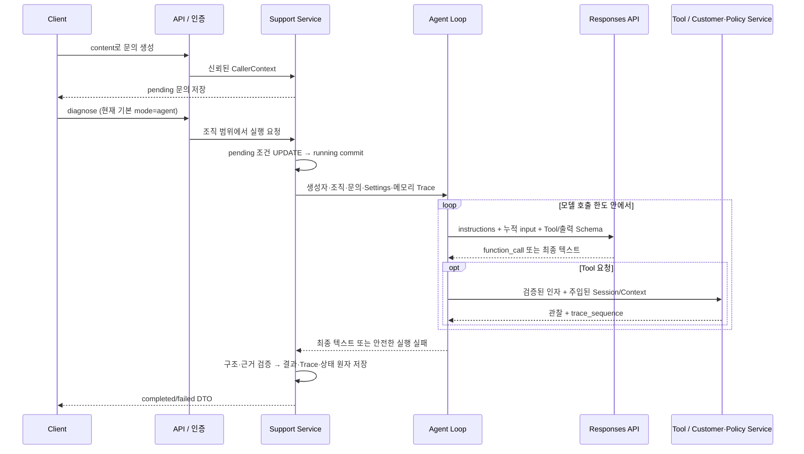

# 02. Support Agent — 선택하는 LLM과 통제하는 Application

[전체 흐름](README.md) · 이전: [Backend](01-backend-foundation.md) · 다음: [Workflow](03-workflow-baseline.md)

## Context — 상태 조회를 문의 진단으로 연결

Backend는 고객 상태를 반환하지만 문의에 어떤 정보가 필요한지, 조회 결과에 따라 무엇을 더 확인해야 하는지는 결정하지 않았다. Issue#2의 [Proposal](../../openspec/changes/archive/2026-10-22-support-agent/proposal.md)은 기존 Service 위에 Single Agent를 붙여 복합 문의를 진단하고 결과·근거·실행을 API에서 회수하는 것을 목표로 했다.

## Requirements — 읽기 전용 진단과 저장 가능한 실행

세 delta spec이 역할을 나눈다. [support-requests](../../openspec/changes/archive/2026-10-22-support-agent/specs/support-requests/spec.md)는 문의·상태·저장·조직 경계, [support-diagnosis](../../openspec/changes/archive/2026-10-22-support-agent/specs/support-diagnosis/spec.md)는 동적 Tool 실행·종료·근거, [policy-search](../../openspec/changes/archive/2026-10-22-support-agent/specs/policy-search/spec.md)는 별도 정책과 결정적인 검색을 정의한다.

결과는 `diagnosed`, `needs_information`, `escalate`이며 모두 유효하면 completed다. 기술 실패와 정보 부족은 다르다. 실제 상태 변경, 자동 재실행/Resume, Background Task, Multi-Agent, MCP, 범용 Agent Framework는 제외했다.

## Design — 선택권과 집행권을 분리

[Design D1~D8](../../openspec/changes/archive/2026-10-22-support-agent/design.md)의 핵심은 LLM이 허용된 조회와 진단을 선택하되, 인증·실행 선점·한도·검증·DB 쓰기는 Python Application이 소유하는 것이다.

## Implementation — 요청부터 종료까지

### 문의와 실행 상태

[지원 Router](../../app/api/support.py)는 content-only 입력을 [Support Service](../../app/services/support.py)에 넘긴다. `RequestCreate`는 trim 후 1~4000자이며 추가 필드를 거부한다. 조직·생성자는 본문 대신 인증 컨텍스트에서 정한다. 생성과 진단을 분리해 실행 실패에도 문의 원문을 보존한다.

`diagnose_request`는 같은 조직/pending 조건 UPDATE로 running을 선점하고 시작을 commit한 뒤에만 LLM을 호출한다. 현재는 `execution_mode`도 함께 확정한다. running/failed 재호출은 409, completed의 같은 mode는 저장 결과를 반환한다. 다른 mode 재호출의 409는 후속 Workflow 단계에서 추가됐다. 동일 조직의 다른 사용자가 실행해도 기본 진단 대상은 문의 생성자다.

[SupportRequest·Diagnosis·AgentTrace](../../app/models/support.py)는 고객 테이블과 분리된 지원 도메인 쓰기다. 문의별 Diagnosis UNIQUE, Trace sequence의 양수·문의별 UNIQUE, 상태/outcome CHECK를 둔다. completed의 결과·시각 일관성과 실패 시 Diagnosis 부재는 Service의 원자 저장이 보장한다.

### 동적 Loop와 읽기 Tool

[run_agent](../../app/agent/loop.py)는 실행당 정책을 한 번 로드하고 대상·조직·기준 UTC·문의를 입력한다. 응답에 function_call이 있으면 같은 턴의 텍스트로 진단을 확정하지 않는다. call_id 형식·중복을 검사한 뒤 요청 순서대로 Tool을 실행한다. 원래 `response.output`의 reasoning 포함 항목과 call_id별 `function_call_output`을 누적한다. `store=False`, `parallel_tool_calls=False`이며 encrypted reasoning은 메모리의 후속 입력에만 사용한다.

[agent/tools.py](../../app/agent/tools.py)는 strict Tool 정의, 현재 [diagnosis/tools.py](../../app/diagnosis/tools.py)는 인자 검증·Service 호출·관찰을 담당한다. 고정 allowlist는 고객 조회 네 개와 `search_policy`다. UUID/검색어/extra 필드를 Application에서도 검증하고, LLM 인자로 Session·CallerContext를 받지 않는다. 관찰은 `{ok, data, error_code, trace_sequence}`다. 타 조직/실제 부재는 동일 `not_found`로 관찰되며, `invalid_arguments`·`unknown_tool`도 다음 판단에 전달할 수 있다. DB 오류는 재전파하고 치명적 내부 오류는 실행을 중단한다.

[정책 파일](../../policies/)은 플랜·권한·구독/결제 문제 해결 세 JSON이다. 초대 조건은 owner/admin, 활성·미만료 구독, `member_count < member_limit`이다. failed/pending 결제만으로 구독 상태를 바꾸지 않는다. [search_policy](../../app/services/policy.py)는 casefold/공백 토큰의 부분문자열 점수, 점수 내림차순·ID 오름차순, 상위 3개를 반환한다. Vector DB·embedding은 없다. 단순 검색의 누락 가능성은 남는다.

### 종료·실패·트랜잭션

기본 제한은 모델 8회, Tool 시도 16회, 실행 Budget 60초다. 잘못된 Tool 시도도 한도에 포함한다. 공통 [ExecutionBudget](../../app/diagnosis/runtime.py)이 monotonic 시간을, [call_model](../../app/diagnosis/llm.py)이 남은 Budget과 요청 Timeout의 최소값을 적용한다. 요청 Timeout 기본 20초의 설정 가능화와 `llm_metadata`는 후속 신뢰성 Change에서 추가됐다. SDK retry는 0이다.

| 실패/결과 | 실행과 저장 계약 |
|---|---|
| 정보 부족·이관 | 유효 결과이면 completed, 질문/이관 안내 저장 |
| refusal / incomplete·잘못된 출력 / 통신 실패 | `model_refusal` / `invalid_output` / `llm_error`, 수정 호출 없이 실패 |
| 횟수 초과 / Budget 소진 | `limit_exceeded` / `execution_timeout`, 후속 작업 중단 |
| DB 실패 | rollback → 가능한 경우 한 번 실패 저장 → 원래 HTTP 503 유지 |

`validate_diagnosis`는 JSON/Pydantic, 같은 실행의 tool_result 참조, 참조한 검색의 실제 정책 ID, diagnosed의 최소 성공 관찰을 확인한다. 문장 내용의 타당성·모든 원인 식별을 증명하는 검사는 아니다. `save_terminal`은 상태·Diagnosis·전체 Trace를 한 번에 commit한다. Tool과 Loop는 commit하지 않는다. 종료 commit 응답이 유실된 경우 재조회하여 기존 completed를 failed로 덮어쓰지 않는다.

Trace는 `execution_started → llm_response/tool_result들 → final_result → execution_completed/failed`다. step은 모델 turn, sequence는 전체 이벤트 순서다. 실행 중에는 메모리에 모으고 종료 시 일괄 저장하므로 프로세스 종료·지속 DB 장애에는 running/Trace 유실이 남을 수 있다. DB 읽기 트랜잭션이 LLM 대기 중 유지되며 READ COMMITTED이므로 전체 실행의 단일 고객 스냅샷을 보장하지 않는다.

## Verification — 구조 검증과 실제 모델 확인의 역할

| 요구사항 | Spec/설계 | 구현 | 핵심 검증 |
|---|---|---|---|
| 관찰에 따른 후속 선택 | [support-diagnosis](../../openspec/specs/support-diagnosis/spec.md) | `run_agent` | [test_agent_loop.py](../../tests/test_agent_loop.py): `test_followup_opaque_multiple_calls`, `test_tool_turn_text_does_not_finish` |
| 읽기·조직 경계·입력 검증 | 같은 Spec + [customer-read-access](../../openspec/specs/customer-read-access/spec.md) | 공통 Tool·Customer Service | [test_policy_tools.py](../../tests/test_policy_tools.py), [test_support_execution.py](../../tests/test_support_execution.py)의 scope/E2E 검사 |
| 구조와 실제 근거 참조 | support-diagnosis의 구조화된 진단 | `validate_diagnosis`, `DiagnosisDTO` | test_agent_loop의 `test_invalid_references`, `test_policy_ids_are_linked_to_same_trace`, `test_successful_observation_required` |
| 선점·원자 저장·장애 | [support-requests](../../openspec/specs/support-requests/spec.md) | `diagnose_request`, `save_terminal` | test_support_execution의 `test_concurrent_claim_and_running_reads`, `test_database_failure_atomicity`, `test_start_commit_failure_calls_no_model` |
| 한도·실제 I/O 취소 | support-diagnosis의 실행 한도 | Budget·Responses I/O | [test_agent_deadline.py](../../tests/test_agent_deadline.py): `test_deadline_cancels_real_http_io`, `test_database_pool_wait_can_exceed_remaining_budget` |
| 정책 검색 재현성 | [policy-search](../../openspec/specs/policy-search/spec.md) | `load_policies`, `search_policy` | test_policy_tools의 검색·로딩·정렬 검사 |

Fake Responses는 Tool/누적 입력/종료 계약을 검사한다. 로컬 HTTP transport 테스트는 SDK 취소 경로를 검사하며 실제 OpenAI 호출은 아니다. [durable fixture](../../tests/conftest.py)는 savepoint만으로 commit을 주장하지 않고 독립 Session에서 저장을 확인한다.

[수정 기록](../../study/support-agent-fixes.md)에 **185 passed, 1 warning**이 있다. SA-02는 READ COMMITTED에서 상태 조회와 Diagnosis 조회 사이에 다른 Session이 종료를 commit하여 running 상태와 새 Diagnosis가 한 DTO에 섞이던 응답 구성의 경합이었다. `request_dto`가 처음 조회한 상태가 completed일 때만 Diagnosis를 읽도록 바꾸고 `test_get_keeps_running_snapshot_during_terminal_commit`으로 보완했다. 저장 원자성 오류나 identity map만의 문제로 설명하지 않는다. SA-01은 LLM I/O 취소를 확보했으나 DB pool/connect 대기는 실행 Budget을 넘을 수 있었다. 이후 [Archive Tasks](../../openspec/changes/archive/2026-10-22-support-agent/tasks.md)는 사용자 승인으로 엄격한 전체 deadline 대신 Budget 계약을 확정했다고 기록한다. 옛 리뷰의 PARTIALLY RESOLVED와 현재 계약을 구분해야 한다.

실제 2026-10-22 [Smoke 보고서](../../.smoke-results/run-m4e9wv6d/report.md)와 JSON에서는 `completed/diagnosed`, 응답 모델 `gpt-5-mini-2025-08-07`, LLM 6회·Tool 5회를 확인했다. [traces.json](../../.smoke-results/run-m4e9wv6d/traces.json)의 member 역할·3/10명·활성 구독·결제·정책과 Evidence를 대조한 기존 검토는 ST-01~ST-05 Pass다. 실제 초대 로그는 없으므로 권한 부족은 관찰·정책 기반 진단이며 직접 원인의 실증은 아니다. 이번 조사에서 API나 테스트를 재실행하지 않았다.

## Outcome — 진단 가능성과 품질 비교는 다른 완료 조건

Issue#2는 Tool 선택부터 결과·Trace의 durable 저장까지 실행 가능한 진단 경로를 만들었다. 하지만 성공 Smoke 하나와 구조 검증으로 진단 품질·비용의 유리함을 판단할 수는 없었다. 같은 입력·데이터·출력 검증 위에서 조회 순서를 Application이 정하는 [Workflow Baseline](03-workflow-baseline.md)이 다음 요구가 됐다.
