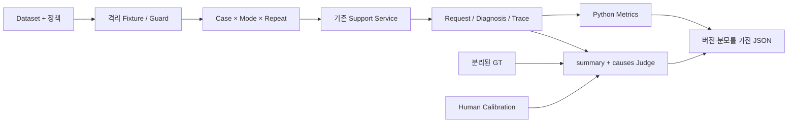

# 04. Evaluation — 실행 기록에서 범위가 명확한 판단으로

[전체 흐름](README.md) · 이전: [Workflow](03-workflow-baseline.md) · 관련: [Design Decisions](05-design-decisions.md)

## Context — “동작한다”에서 “어떤 조건에 적합한가”로

Issue#4의 [Proposal](../../openspec/changes/archive/2026-10-29-agent-workflow-evaluation/proposal.md)은 같은 입력에서 현재 Sequential Agent와 Fixed-step Workflow의 품질·효율·안정성을 비교하는 체계를 요구했다. 앞 단계는 Trace를 남겼지만 의미 정답, 공정한 반복 조건, 실패를 포함하는 집계는 없었다.

[MVP](../mvp.md)는 30개 Case와 더 넓은 품질 지표를 계획했다. 실제 [diagnosis-evaluation Spec](../../openspec/specs/diagnosis-evaluation/spec.md)은 초대 실패 5개 Case, 1회/5회 반복, 제한된 Metrics로 구체화했다. 범위 축소는 30개를 완료했다는 뜻이 아니라 작은 실험을 끝까지 수행하는 선택이다.

## Requirements — 무엇을 평가하고 무엇을 남기는가

- 같은 Fixture·정책·Service·모델과 공통 시간 설정에서 방식별 새 문의를 실행한다.
- 실행 성공과 원인 정답을 분리하고 LLM/Tool Calls, Tokens, 추정 비용, Service E2E 지연을 계산한다.
- GT와 모델 입력을 분리하고 독립 Judge를 사람 기준 예제로 Calibration한다.
- 실패·결측·중단·환경 오류를 보존하고 성공 실행/전체 시작 실행의 분모를 드러낸다.
- Dataset/GT/정책·코드·Prompt·모델·가격·원본 Trace를 보존해 별도 재채점이 가능해야 한다.

Groundedness, Task Success, Safety, Tool Selection Quality의 독립 채점, 통계적 유의성 검정, Hybrid Routing, 병렬 호출, Prompt 최적화는 Evaluation Proposal의 비범위다. 다만 실제 이력에는 후속 Prompt 보완이 있으므로 아래에서 구분한다.

## Design / Implementation — 진단과 평가를 분리

[Design D1~D9](../../openspec/changes/archive/2026-10-29-agent-workflow-evaluation/design.md)은 [evaluation 패키지](../../evaluation/)를 Application 밖에 두고 기존 Support Service를 직접 호출했다. HTTP Runner는 Backend·인증·원격 DB 설정이 더 필요하므로 제외했다. 새 진단 엔진이나 평가용 비즈니스 Service는 만들지 않았다.

### Golden Set — 문의는 같고 실제 고객 조건만 다르다

[invite_cases.json](../../evaluation/data/invite_cases.json)의 공통 문의는 “팀원을 초대하려고 하는데 계속 실패합니다. 무엇이 문제인지 확인해 주세요.”다. [invite_gt.json](../../evaluation/data/invite_gt.json)은 기대 outcome·모든 필수 원인·대표 제외 원인·필수 사실·정책 근거를 별도 보관한다. 원인 ID를 진단 출력 Schema에 강제하지 않는다.

| Case | 요청자 / 인원·한도 | 구독 | 기대 outcome / 원인 |
|---|---|---|---|
| C01 | member / 2·3 | active, 기준 +30일 | diagnosed / permission_denied |
| C02 | admin / 2·2 | active, +30일 | diagnosed / member_limit_reached |
| C03 | admin / 2·3 | expired, -30일 | diagnosed / subscription_expired |
| C04 | admin / 2·3 | active, +30일 | needs_information / 현재 자료로 원인 확정 불가 |
| C05 | member / 2·2 | expired, -30일 | diagnosed / 위 세 원인 모두 |

모든 Case는 요청자와 보조 owner 각 1명, pro 구독, 기준 -60일의 성공 결제 1건이다. 결제 실패라는 추가 변수를 제거하면서 구독 상태와 결제 이력을 독립된 사실로 유지한다. GT의 `required_facts`는 의미 판단의 맥락이며 답변에 모든 사실을 나열하라는 조건이 아니다.

[load_bundle / validate_bundle](../../evaluation/dataset.py)는 Case 순서·조건·원인 조합·outcome·정책 ID의 일관성을 검사한다. 자연어 GT 전체의 정당성을 자동 증명하지는 않는다. [customer_rows](../../evaluation/fixtures.py)는 run+Case+레코드 키로 UUID를 만들고 정답을 드러내지 않는 조직명을 사용한다. 모델 입력에 Case ID·GT 원인·다른 모드 답변이 섞이지 않도록 테스트한다.

### 실행 격리와 공통 조건

[validate_database_urls / create_run_schema](../../evaluation/fixtures.py)는 개발/테스트와 다른 Evaluation DB 이름, 실제 `current_database`, 새 `eval_<uuid>` schema와 search_path를 확인한다. 기존 schema 재사용·public fallback·개발 Seed 갱신·자동 삭제는 없다. Fixture는 한 트랜잭션으로 구성하고 기존 인증/조회 Service로 실제 DTO를 확인한다.

`FixtureGuard.check`는 실행 전후 고객 snapshot/hash·정책 hash와 실제 UTC에서의 만료 조건을 검사한다. 차이가 나면 후속 실행을 중단하고 비교를 무효화한다. 모든 Request/Trace 시각을 같은 값으로 만드는 방식 대신 만료일을 ±30일로 분리한다. 테스트의 고정 시계와 실제 평가의 UTC 시각을 혼동하지 않는다.

[execution_plan / run_collection](../../evaluation/runner.py)은 반복 → C01~C05 → mode 순서다. 홀수 반복 Agent→Workflow, 짝수 Workflow→Agent이며 매번 새 문의를 만든다. 반복은 1 또는 5로 총 10 또는 50회다. 5회이면 시작 mode 비중은 3:2다. 세션도 실행별로 분리하지만 기존 Support Service가 commit/rollback을 소유한다. 진단 재시도·자동 재개는 없다.

### Metrics — 분모와 측정 경계

[metrics.py](../../evaluation/metrics.py)는 누락을 0으로 메우지 않는다. 완전한 Trace의 호출이 실제 0회일 때만 0이고, usage/모델 단가/Trace가 불완전하면 `value=null`, 부분 관측 `observed`, 누락 수·이유를 남긴다. Judge overhead는 진단 비용과 분리한다.

| 관점 | 실제 정의 | 해석 경계 |
|---|---|---|
| Outcome: Execution Success | 유효 Diagnosis가 completed로 저장된 실행 / 시작 실행 | 의미 오답·needs_information도 실행 성공일 수 있음 |
| Outcome: Diagnosis Correctness | `correct / (correct + incorrect)` | not_applicable/pending/review_required 제외. 실패 포함 성공률과 함께 읽음 |
| Process: 지연 | 생성 Service 호출 직전~diagnose 반환/예외까지 monotonic ms | 생성·실행·종료 저장 포함. 인증/preflight·사후 수집·Judge·파일 I/O·HTTP 전송 제외 |
| Process: 호출·Tokens | llm_response/tool_result 시도 수, 공급자 usage 필드별 합 | 오류 시도 포함. Total 누락을 input+output으로 채우지 않음 |
| Process: 비용 | 응답 모델별 input/output 단가와 Decimal 환산 | 캐시·할인·세금 미반영 추정치, 청구액 아님 |
| Robustness: 반복·실패 | Case×Mode, Mode 전체의 상태·실패·결측·censored | 별도 Robustness score나 장애 주입 실측이 아님 |

수치 통계는 실패를 포함한 `all_started`와 `successful_metrics`를 각각 보존한다. 불완전 실행의 관찰 지연은 censored이며 최종 완료 지연 평균에 섞지 않는다. Request 시작/종료 차이·Trace 단계 합계·Service E2E는 서로 다른 경계다.

**구현의 세부 한계:** `collect_execution`은 completed + Diagnosis 존재로 `execution_success=True`를 정하고, `traces_complete`에서 근거 검증·Trace 완전성을 별도 검사한다. Spec의 “기존 참조 검증을 통과한 실행 성공”은 정상 Service 저장 경로에서 충족되지만, 수집 때 근거 재검증이 실패했다고 성공 플래그를 false로 되돌리지는 않는다. 본 평가에서는 완전한 Trace와 지표가 확인돼 결과 차이를 발견하지 않았으나, 손상·부분 수집 상황에서 두 조건이 동일하다고 설명하지 않는다.

### Judge와 Calibration

[Judge.grade](../../evaluation/judge.py)는 GT와 `summary + causes`만 의미 비교한다. mode·실행/Case ID·Trace·성능·다른 답변·실제 outcome·next_actions·evidence는 입력에서 제외한다. 독립 요청, strict 출력, retry 0이며 Judge 요청 Timeout은 기본 20초로 진단 Timeout과 별도다.

Complete Diagnosis는 **primary_causes 모두 식별 + 잘못된 추가 원인 없음 + 기대 outcome 일치**다. 동의 표현을 허용하고 사실 생략만으로 오답을 강제하지 않는다. 필수 사실과 반대되는 주장은 오답 근거가 될 수 있다. C04는 추가 정보 필요를 표현하고 근거 없는 장애 등을 확정하지 않아야 한다. 다음 행동에서 “구독을 확인하라”고 권고하는 것만으로 구독 만료 원인을 식별한 것은 아니다.

Python은 실제 outcome 일치를 따로 계산한다. Diagnosis 부재는 not_applicable, Judge 기술/형식 오류는 pending, 유효 Judge 응답에서 outcome 불일치는 incorrect, 나머지는 의미 판정을 반영한다. `review_required`는 의미가 불명확한 답변이고 기술 오류와 다르다.

`run_calibration`은 최소 15개의 대표 예제·확정 Human Label·검토 기록을 요구한다. 일치율 ≥90%, Judge 기술 실패 0, 지정 핵심 오답의 false-correct 0이 초기 검토 통과 조건이다. 실패 Judge를 분모에서 빼지 않는다. correct/incorrect 기준 예제는 필수, review_required는 선택이며 없는 유형은 미검증으로 표시한다. [v2 입력](../../evaluation/data/judge_calibration_v2.json)은 15건, 미확정 K16은 [별도 draft](../../evaluation/data/judge_calibration_k16_draft.json)다.

본 평가에 연결된 [실제 Calibration v2](../../.evaluation-results/calibration-v2.json)는 15/15 일치, 사람 Label correct 8·incorrect 7, 기술 실패/핵심 false-correct 0, review_required 기준 예제 0이다. 모델·Prompt/Rubric·GT·실제 응답 모델의 버전 일치도 저장돼 있다. 이것은 15개 Set에서의 검토 통과이며 본 평가 전체의 독립적인 사람 채점 또는 일반적 Judge 정확성 100%가 아니다.

### 원본 보존과 재채점

[ResultStore / build_manifest / prepare_regrade](../../evaluation/results.py)는 네 JSON을 관리한다. manifest는 코드 revision/dirty·관련 코드 hash·Dataset/GT/정책 snapshot·설정/실제 모델·Budget/Timeout·가격·순서를, executions는 Request/Diagnosis/Trace·실패·원시 지표를 보존한다. judgments는 판정/버전/Calibration/overhead, summary는 분모와 집계를 담는다.

파일별 임시 파일 → atomic replace를 쓰지만 네 파일 전체의 원자성은 보장하지 않는다. 수집 후 executions는 불변, 최초 채점은 placeholders만 확정하고 재채점은 `regrades/<id>/`와 source hash로 원본과 연결한다. [CLI](../../scripts/evaluate.py)의 plan은 외부 호출 없이 계획만 검사하고 run/calibrate/judge는 각각 명시적 live 옵션을 요구한다. 이번 조사에서는 어떤 live 명령도 실행하지 않았다.

## 개발 중 발견한 문제와 후속 변경

| 시점 / 증거 | 확인된 사실 | 후속 대응과 해석 제한 |
|---|---|---|
| [초기 Pilot invite-10](../../.evaluation-results/invite-10/manifest.json), `bf64790` + dirty | C04 Agent limit_exceeded, C04/C05 Workflow llm_error. 미채점/uncalibrated여서 품질 결론 준비 안 됨 | 약 20초 LLM 실패의 원본 예외가 없어 Timeout 확정 불가 |
| [LLM 신뢰성 Change](../../openspec/changes/archive/2026-10-29-improve-llm-execution-reliability/design.md) | 기존 요청 20초 고정, 평가 Settings의 Budget 환경 반영 누락, 예외 분류 손실 | 요청 Timeout 설정·CLI 우선순위·동등 Budget 검사·llm_metadata·Migration 002 추가. 기본 20/60초·retry 0 유지 |
| [Pilot v2](../../.evaluation-results/invite-10-v2/manifest.json), dirty | 요청 30초, 10회 모두 completed이나 원본 채점은 pending | 원본 수집 성공을 품질 개선으로 대체하지 않음. 재채점 디렉터리도 별도로 존재 |
| Git `723a9da` | Calibration v2/신뢰성 변경과 함께 공통 OUTPUT_CONTRACT·Prompt snapshot·계약 테스트 추가 | 추측을 causes에서 제외, 정보 부족 시 질문, 일부 확인 원인 유지 등을 명시. 별도 delta spec·채택 대안/결정 근거는 미확인 |
| [Pilot v3](../../.evaluation-results/invite-10-v3/manifest.json), `723a9da`, clean | 10회 모두 completed/correct, quality_conclusion_ready=true | Prompt·설정·Calibration·실행 변동이 섞인 소표본. 특정 변경의 인과 효과를 주장하지 않음 |
| 본 평가 후 [실패 관측성 Change](../../openspec/changes/archive/2026-10-29-diagnosis-failure-observability/design.md), `4e7cf42` | invalid_output 세 건의 JSON/Schema/참조 등 세부 구분 불가 | 고정 stage/reason/path와 Migration 003·실행별 집계 추가. 과거 원인 backfill·실패율 개선 측정 없음 |

Runtime 분리·초기 Evaluation의 Prompt 불변 원칙은 해당 변경 당시 범위다. 실제 본 평가는 `723a9da`의 변경된 Prompt를 사용했으므로 초기 Prompt의 성능 결과처럼 서술할 수 없다. `OUTPUT_CONTRACT`는 실제 Schema의 수락 기준을 강화한 코드 validator가 아니라 모델 지침이다.

현재 `llm_metadata`는 요청에 적용한 Timeout과 허용 목록의 예외 타입·is_timeout·HTTP status를 남긴다. `failure_metadata`는 `invalid_output`의 단일 `final_result`에만 JSON/Schema/근거 등 **거부 경계**를 남긴다. 원문·메시지·추론은 수집하지 않으며 공급자 내부 Root Cause를 증명하지 않는다. [invalid_output_summary](../../evaluation/metrics.py)는 최종 저장 오류와 하나의 canonical final_result를 기준으로 실행당 한 번만 분류한다. 옛 metadata 없는 실패는 unclassified다.

## Verification — 자동화 계약과 실측 근거

| 요구사항 | Spec 근거 | 구현 | 검증 근거 |
|---|---|---|---|
| Dataset/GT 분리·조건 | [diagnosis-evaluation](../../openspec/specs/diagnosis-evaluation/spec.md) | `load_bundle`, `validate_bundle` | [test_evaluation_dataset.py](../../tests/test_evaluation_dataset.py): `test_fixed_dataset_and_separate_gt`, `test_bad_dataset_rejected_before_side_effects` |
| 격리·동결 감지 | 같은 Spec의 Fixture/실행 조건 | `create_run_schema`, `FixtureGuard` | [test_evaluation_fixtures.py](../../tests/test_evaluation_fixtures.py): 실제 DTO·sentinel 보존·중복 schema 거부·변경 감지 |
| 10/50회·새 문의·지연 경계 | 같은 Spec의 반복/계측 | `execution_plan`, `collect_execution` | [test_evaluation_runner.py](../../tests/test_evaluation_runner.py): `test_order_new_requests_shared_fixture_real_services_fake_responses`, `test_latency_boundary_excludes_auth_collection_and_files` |
| 실패·결측·분모·비용 | 같은 Spec의 Metrics | `trace_metrics`, `summarize` | [test_evaluation_metrics.py](../../tests/test_evaluation_metrics.py): 부분 usage·0/null·Decimal·censoring |
| Blind Judge·판정·Calibration | 같은 Spec의 Correctness/Calibration | `Judge.grade`, `run_calibration` | [test_evaluation_judge.py](../../tests/test_evaluation_judge.py): 입력 allowlist·판정/버전·false-correct·미검증 범위 |
| 원본·별도 재채점·호출 게이트 | 같은 Spec의 결과/재채점 | `ResultStore`, CLI | [test_evaluation_results.py](../../tests/test_evaluation_results.py), [test_evaluation_cli.py](../../tests/test_evaluation_cli.py) |
| Timeout/오류 보존 | [llm-execution](../../openspec/specs/llm-execution/spec.md) | Settings·call_model·CLI | [test_llm_reliability.py](../../tests/test_llm_reliability.py), [저장](../../tests/test_llm_trace_storage.py), [양 Runner 통합](../../tests/test_evaluation_timeout_integration.py) |
| 출력 실패 분류·원자 저장·호환 | [diagnosis-output-failures](../../openspec/specs/diagnosis-output-failures/spec.md) | validate_diagnosis·FailureMetadata·집계 | [test_diagnosis_failure_observability.py](../../tests/test_diagnosis_failure_observability.py), [test_diagnosis_failure_storage.py](../../tests/test_diagnosis_failure_storage.py) |

[Runbook](../evaluation_runbook.md)의 당시 기록은 초기 Framework 전체 **425 passed, 1 warning**, Calibration v2 작업 중에는 일부 Fake 검증 성공과 전체 **228 passed / 27 failed / 272 errors**다. 후자는 DB 설정 부재·소켓 제한 환경의 실패 기록이며 전체 통과로 바꿔 쓰지 않는다. [실패 관측성 Tasks의 후속 사용자 로컬 기록](../../openspec/changes/archive/2026-10-29-diagnosis-failure-observability/tasks.md)은 저장/API **13 passed**, 전체 **672 passed**, 경고 1건으로 이후 검증을 남겼다. 이번 문서 조사에서 테스트를 재실행하지 않았다.

## 1차 실측 — 원본과 직접 대조한 사실

원본은 로컬 [invite-50-v1](../../.evaluation-results/invite-50-v1/)의 manifest/executions/judgments/summary다. Run ID `ffcd91b5-8300-4b97-8c33-05419e92de4f`, 2026-10-27 09:50:02~10:07:21 UTC, `723a9da`, dirty=false다. 50회 수집, valid_comparison/quality_conclusion_ready는 true다. 설정 모델 `gpt-5-mini`, 실제 응답 `gpt-5-mini-2025-08-07`, Dataset/GT는 invite-v1/invite-gt-v1, 요청 30초·양 Budget 60초였다.

이번 조사에서 네 파일의 SHA-256을 [기존 결론](../evaluation/first-evaluation-conclusion.md)과 대조해 모두 일치함을 확인하고, executions/judgments의 원시 건수와 지표 평균도 재계산했다. 평가·Judge를 재호출하거나 파일을 다시 저장하지 않았다.

| Outcome 지표 | Agent | Workflow |
|---|---:|---:|
| 실행 성공 / 시작 | 23/25 (92%) | 24/25 (96%) |
| 의미 정답 / 오답 | 22 / 1 | 24 / 0 |
| Diagnosis Correctness | 22/23 (95.65%) | 24/24 (100%) |
| 시작 대비 완전한 정답 — 보조 계산 | 22/25 (88%) | 24/25 (96%) |
| invalid_output / not_applicable | 2 / 2 | 1 / 1 |

incomplete·환경 오류·pending·review_required는 양쪽 모두 0이다. Workflow의 Correctness 100%는 실패 1건을 제외한 24건의 값이다.

| Process 지표 — 실패 포함 all_started, 모드별 n=25 | Agent | Workflow |
|---|---:|---:|
| 평균 Service E2E ms | 23,011.68 | 18,224.83 |
| 평균 LLM / Tool Calls | 5.12 / 4.12 | 1.00 / 7.00 |
| 평균 Input / Output Tokens | 7,976.96 / 2,296.56 | 1,736.40 / 2,345.88 |
| 평균 Total Tokens | 10,273.52 | 4,082.28 |
| 평균 추정 비용 USD | 0.00658736 | 0.00512586 |

위 지표의 missing/censored는 모두 0이다. 비용은 당시 manifest의 `2026-10-26-v1` 가격표(입력 0.25/출력 2.00 USD per million Tokens)로 계산한 값이며 현재 가격 안내가 아니다. 현재 가격을 새로 조회해 과거 비용을 바꾸지 않았다.

### C05 — 실행 성공이지만 불완전한 원인 진단

Agent C05 반복 2의 실행 `483bc540-2aaf-50bd-b5c9-7f12dcf12ed4`는 completed/diagnosed이고 outcome도 일치했다. 하지만 원본 Trace는 `get_user → get_organization → search_policy`뿐이며 `get_subscription`이 없다. summary/causes는 권한 부족과 인원 한도를 확정하고 구독은 미확인으로 남겼다. next_actions의 구독 확인 권고는 실제 만료 원인 식별이 아니다. GT의 세 원인 중 `subscription_expired`가 누락돼 Judge incorrect와 일치한다.

이는 현재 확인할 수 있는 필수 원인을 모두 찾기 전에 끝난 **진단 완전성 실패**다. 모델 내부 종료 동기는 알 수 없다. “첫 차단 원인 하나”를 성공 기준으로 바꾸면 평가 질문 자체가 바뀌므로 사후 GT를 조정하지 않는다.

별도의 실행 실패는 Agent C03 반복 4·C05 반복 4, Workflow C03 반복 5의 invalid_output 세 건이다. 모두 Diagnosis가 없고 당시 failure_metadata도 없어 의미 오답과 구분한다. 응답 상태·JSON·Schema·참조 오류 중 어느 것인지는 미확정이다. Token 수나 정상 llm_response 이벤트로 추정하지 않는다.

## Outcome — 사실, 해석, 다음 검증

**관찰 사실:** 이번 표본에서 Workflow는 더 높은 실행 성공/정답 비율과 낮은 평균 지연·추정 비용을 보였다. Agent의 Tool Calls는 적지만 LLM Calls와 누적 입력 Tokens는 많았다. Workflow도 출력 실패 1건이 있었다.

**채택한 해석:** 확인할 조건이 작고 알려져 있고 모든 원인이 필요한 현재 초대 진단에는 Workflow를 우선한다. 저렴한 일곱 조회 중 일부를 생략하는 이득보다 반복 LLM 비용과 원인 누락 관리 부담이 컸다는 [기존 결론](../evaluation/first-evaluation-conclusion.md)의 판단은 원본과 부합한다. 동적 선택만의 인과 효과나 모든 Workflow의 우월성을 입증한 것은 아니다.

**남은 한계·후속 질문:** 5개 Case 반복은 50개 독립 업무가 아니다. 순차 실행·3:2 시작 비중·alias·환경 변동, 서로 다른 Prompt/문맥이 남는다. Trace 참조 검증은 Groundedness 채점이 아니며 evidence/next_actions·안전성·실제 초대 성공은 독립 검증하지 않았다. 다음 평가는 필요한 정보가 문의마다 달라지는 Case, 추가 탐색의 가치와 완전성, Judge의 review_required·독립 사람 검토, 실패 관측성 이후 새 run을 다룰 수 있다. Hybrid/병렬 호출/Prompt 개선의 성능은 아직 측정하지 않았다.

**자료·운영 확인 필요:** Runbook은 v2 `examples_reviewer=null`이라고 서술하지만 현재 입력과 저장 Calibration snapshot은 `rigel`이다. 초기 미실측/환경 실패 절은 당시 기록이고 본 평가와 다르다. Migration 003의 기존 개발 DB 적용은 미확인이다. 이러한 차이를 본 평가 결과 파일에 소급 반영하거나 원본을 수정하지 않았다.
