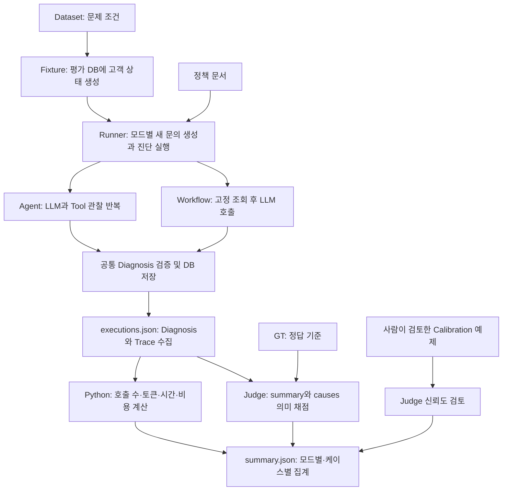

# Evaluation과 Agent 실행 흐름 및 필드 해설

이 문서는 2026-10-29의 구현을 기준으로, 평가 데이터가 진단 입력이 되고 실행 기록과 점수로 바뀌는 과정을 설명한다. 아래 JSON과 수치는 설명용 예시이며 실제 측정 결과가 아니다. 실행 절차는 [Evaluation Runbook](evaluation_runbook.md)을 참고한다.

## 1. 이 프로젝트에서 평가하려는 것

목표는 동일한 고객 문제를 Agent와 고정 Workflow로 풀었을 때 **진단 품질, 실행 안정성, 시간과 비용이 어떻게 달라지는지** 확인하는 것이다.

- Agent: LLM이 관찰 결과를 보고 다음 Tool과 종료 시점을 선택한다.
- Workflow: Application이 정해진 조회를 수행하고 LLM이 한 번 진단한다.
- 공통 기반: 고객 DB, 정책, Service, Tool 실행기, 진단 출력 계약과 검증 로직을 공유한다.

[MVP 문서](mvp.md)의 30개 케이스는 초기 목표다. 현재 구현은 초대 실패 문의 **5개 케이스 × 2개 모드 × 1회 또는 5회 반복**, 즉 10개 또는 50개 실행이다. 현재 결과만으로 모든 Agent와 Workflow의 우열을 주장할 수는 없다.

## 2. 전체 흐름



진단 수집과 채점은 별도 단계다. 답변을 얻었다고 정답 판정까지 완료된 것은 아니다. 수집한 답변을 재사용해 나중에 Judge를 바꾸어 재채점할 수도 있다.

평가 Runner는 HTTP API를 호출하지 않고 `support.create_request()`와 `support.diagnose_request()`를 직접 사용한다. 실제 서비스의 진단 로직을 통과하지만 HTTP 전송 시간은 측정하지 않는다.

## 3. Fixture, Seed, Migration은 왜 필요한가?

### 3.1 서로 다른 책임

| 구성 요소 | 바꾸는 대상 | 이 프로젝트에서의 역할 |
|---|---|---|
| Migration | 기존 DB의 테이블 구조와 제약 | 기존 DB를 변경된 코드가 기대하는 구조로 갱신 |
| Seed (`app/seed.py`) | 개발용 초기 데이터 | 개발과 시연에 사용할 고객 상태 마련 |
| 평가 Fixture (`evaluation/fixtures.py`) | 평가 전용 고객 데이터 | 케이스 조건을 실제 DB에 재현하고 실행 중 동일 조건 유지 |
| pytest fixture (`tests/`의 fixture) | 테스트 준비와 의존성 | 테스트용 Session, Fake Client 등 준비·정리 |

같은 fixture라는 단어를 써도 평가 Fixture가 반드시 pytest의 `@pytest.fixture`라는 뜻은 아니다. 여기서는 **반복 가능한 평가 조건을 만드는 데이터와 준비 코드**를 뜻한다.

### 3.2 Migration: 이미 존재하는 테이블을 바꾸기 위해

ORM 모델에 컬럼을 추가해도 기존 테이블이 자동 변경되지는 않는다. `Base.metadata.create_all()`은 없는 테이블을 만들지만 기존 테이블의 컬럼과 제약을 새 모델에 맞게 갱신하지 않는다.

| SQL 파일 | 추가 내용 | 필요한 이유 |
|---|---|---|
| `001_workflow_execution_mode.sql` | `support_requests.execution_mode`와 상태 제약 | 어느 모드로 실행했는지 기록. 기존 비-pending 문의는 Agent로 채워 기존 기록을 보존 |
| `002_llm_trace_metadata.sql` | `agent_traces.llm_metadata` JSONB | 요청 timeout과 안전하게 분류한 LLM 오류 정보 저장 |
| `003_diagnosis_failure_metadata.sql` | `agent_traces.failure_metadata` JSONB | `invalid_output`이 발생한 단계와 이유 저장 |

001의 제약은 pending이면 모드가 null이고, running/completed/failed이면 agent 또는 workflow가 있어야 한다는 규칙이다. 미실행 문의에 실행 모드를 잘못 붙이거나 실행된 문의의 모드를 잃는 것을 막는다.

평가는 별도 PostgreSQL DB에서 run마다 새 `eval_<run UUID>` schema를 만들고 현재 ORM으로 테이블을 생성한다. **이 경로에서는 기존 schema에 migration을 적용하거나 재사용하지 않는다.** Migration은 기존 개발 DB를 갱신하는 문제이고, 평가 Fixture는 새 평가 환경의 데이터를 구성하는 문제다.

### 3.3 평가 Fixture: 같은 문제를 풀게 하기 위해

예를 들어 Agent 실행 때는 조직원이 2명인데 Workflow 실행 때는 3명이면, 결과 차이가 구조 때문인지 입력 변화 때문인지 구분하기 어렵다.

Fixture는 다음을 보장하려고 구성되어 있다.

- 개발·테스트 DB와 이름이 다른 평가 DB를 확인하고, run별 새 schema를 사용한다.
- 케이스별 조직, 사용자, 구독, 결제 행을 Dataset으로부터 생성한다.
- UUID는 `uuid5(run_id, case_id와 데이터 종류)`로 생성한다. 같은 run과 케이스의 참조는 일관되고 run 간에는 분리된다.
- `reference_time`에 날짜 offset을 더해 만료일과 결제일을 생성한다. 고정 달력 날짜가 시간이 지나 다른 상태가 되는 문제를 줄인다.
- 각 실행 전후에 고객 snapshot과 정책 hash를 검사하고 실제 Service DTO로 조건을 확인한다.

평가 중 고객 상태·정책·시간 조건이 달라지면 run을 무효 환경으로 표시한다. 고객 데이터 snapshot에는 진단 과정에서 새로 생기는 문의와 Trace는 포함하지 않는다. 이들은 실행 산출물이므로 증가하는 것이 정상이다.

평가 schema는 자동 삭제하지 않는다. 조사할 원본을 남기는 대신 사용자가 run과 schema를 확인하여 관리해야 한다.

## 4. Dataset과 GT 필드는 왜 분리되어 있는가?

Dataset은 **풀어야 할 문제의 세계**, GT(Ground Truth)는 **그 문제의 정답 기준**이다. 정답을 진단 LLM에게 주면 실제 진단 능력을 평가하기 어렵기 때문에 경계를 나눈다.

### 4.1 `invite_cases.json`: 고객 상태의 재료

| 필드 | 의미와 이유 |
|---|---|
| `dataset_version` | 문제 조건의 버전. 다른 버전끼리 같은 실험으로 오해하지 않도록 기록 |
| `content` | 모든 케이스가 공유하는 초대 실패 문의. 문구 차이보다 고객 상태 차이를 비교 |
| `case_id` | C01~C05. Dataset, GT, 실행과 집계를 연결하는 키 |
| `requester_role` | 문의자의 예상 역할. 생성된 인증 Context와 일치하는지 검증 |
| `users[].key` | requester/owner를 지정하는 Fixture용 논리 이름. UUID 생성에 사용 |
| `users[].role` | 실제 저장할 역할. 권한 문제와 조직원 수 조건을 구성 |
| `member_limit` | 조직의 실효 인원 한도. 현재 인원과 비교하는 값 |
| `subscription.plan/status` | 플랜과 저장된 구독 상태 |
| `expires_offset_days` | 기준 시각에서 만료일까지의 상대 일수 |
| `payments[].status` | 결제 상태. 현재 5개 케이스에서는 동일한 성공 결제 |
| `created_offset_days`, `paid_offset_days` | 기준 시각 대비 결제 생성·완료 날짜. 현재 모두 -60일 |

`member_count`는 Dataset에 중복 저장하지 않고 실제 User 행 수로 계산한다. 현재 모든 조직은 2명이다. `member_limit=2`이면 이미 한도에 도달한 것이며, 반드시 한도를 초과해야만 문제가 되는 것은 아니다.

### 4.2 `invite_gt.json`: 정답 기준

| 필드 | 의미와 이유 |
|---|---|
| `gt_version` | 정답 기준의 버전. 문제 데이터가 같아도 채점 기준은 수정될 수 있음 |
| `expected_outcome` | 원인 진단인지 추가 정보 요청인지에 대한 기대 행동 |
| `primary_causes` | 반드시 찾아야 할 원인 목록. C05의 원인 하나만 맞혀서는 충분하지 않음 |
| `excluded_causes` | 주장하면 안 되는 잘못된 원인. 맞는 원인에 추측을 덧붙이는 오답도 구분 |
| `required_facts` | 원인의 의미와 사실관계를 설명하는 채점 맥락. 답변에 모든 문장을 복사하라는 요구는 아님 |
| `policy_document_ids` | 정답 조건과 관련된 정책 문서 ID. Bundle 검증에 사용하며 의미 Judge 입력에는 직접 포함하지 않음 |

| 케이스 | 상태 차이 | 기대 결과 |
|---|---|---|
| C01 | member, 2/3명, 활성 구독 | 권한 부족 |
| C02 | admin, 2/2명, 활성 구독 | 인원 한도 도달 |
| C03 | admin, 2/3명, 만료 구독 | 구독 만료 |
| C04 | admin, 2/3명, 활성 구독 | `needs_information`: 현재 정보로 원인 확정 불가 |
| C05 | member, 2/2명, 만료 구독 | 권한·한도·만료 세 원인 모두 |

C04는 “시스템이 정상임을 증명한 사례”가 아니다. 조회 범위에서 원인을 찾지 못했으므로 오류 메시지 등 추가 정보를 요청해야 한다. 장애나 결제 실패를 임의로 단정하면 오답이다.

## 5. Agent와 Workflow의 실행 과정

### 5.1 공통 Application 책임

문의는 pending → running → completed 또는 failed로 진행된다. Application은 인증된 Context로 고객 접근 범위를 제한하고 실행 모드, 시간, 최종 진단과 Trace를 저장한다. LLM이 다른 조직 ID를 제시해도 그 ID만 믿고 조회를 허용하지 않는다. 모든 Tool은 읽기 전용이다.

LLM이 JSON을 반환하면 공통 `validate_diagnosis()`가 구조와 근거 참조를 검사한다. 이 검증을 통과한 completed는 **유효한 형식과 참조로 진단을 생성했다**는 의미다. 원인을 맞혔는지는 이후 Evaluation이 판단한다.

### 5.2 Agent: 관찰을 받아 다음 행동 결정

1. 문의자 ID, 조직 ID, 기준 UTC, 문의 내용을 LLM에 전달한다.
2. LLM이 Tool 호출을 반환하면 Application이 이름·인자를 검증하고 Service를 실행한다.
3. 관찰을 Trace에 저장하고 `function_call_output`으로 LLM 입력에 추가한다.
4. 기존 모델 출력과 관찰을 포함한 대화 이력으로 다음 LLM 호출을 수행한다.
5. Tool 호출 없이 최종 텍스트를 반환하면 공통 진단 검증으로 넘어간다.

`call_id`는 모델의 호출과 반환을 연결한다. 중복·빈 호출 ID는 잘못된 출력으로 처리한다. step 수, Tool 호출 수, 실행 시간 예산으로 반복을 제한한다. 무한히 조회하거나 자동 재시도하지 않는다.

### 5.3 Workflow: 고정 관찰 후 한 번 진단

정상 경로는 `get_user` → `get_organization` → `get_subscription` → `get_payment_history` → `search_policy("플랜")` → `search_policy("권한")` → `search_policy("구독 결제")` 순서다.

이 7개 결과를 모아 LLM에 한 번 전달한다. LLM의 추가 Tool 호출은 허용하지 않는다. 따라서 Workflow의 정상 경로는 Tool 7회, LLM 1회다. 중간 실패가 발생하면 그보다 적을 수 있다.

Agent는 불필요한 조회를 줄일 가능성이 있지만 여러 LLM 왕복과 누적 입력 토큰이 필요할 수 있다. Workflow는 항상 같은 정보를 모으므로 간단한 문제에도 조회량이 크지만 호출 구조는 예측하기 쉽다. 이것은 검증할 설계상의 가능성이며, 실제 성능 결론은 측정이 필요하다.

## 6. Observation은 왜 이런 구조인가?

Observation은 **Tool을 실행해서 실제로 얻은 정보**다. 모델이 생성한 원인이나 평가 점수가 아니다.

```json
{
  "ok": true,
  "data": {
    "id": "00000000-0000-0000-0000-000000000001",
    "organization_id": "00000000-0000-0000-0000-000000000002",
    "role": "member"
  },
  "error_code": null,
  "trace_sequence": 3
}
```

| 필드 | 역할과 구성 이유 |
|---|---|
| `ok` | 조회 성공 여부. 데이터가 없다는 것과 기술 오류를 혼동하지 않도록 함 |
| `data` | Tool별 Service DTO 또는 정책 검색 결과. LLM이 실제 상태를 판단하는 재료 |
| `error_code` | `not_found`, `unknown_tool`, `invalid_arguments` 같은 안전한 오류 코드 |
| `trace_sequence` | 이 관찰이 기록된 Trace 순번. 최종 evidence가 가리킬 수 있는 주소 |

Tool마다 payload는 달라도 바깥 구조는 같다. Agent와 Workflow가 같은 방식으로 성공·실패·출처를 다룰 수 있고 검증도 공통화할 수 있다.

| Tool | `data`의 주요 내용 | 판단에 필요한 이유 |
|---|---|---|
| `get_user` | id, organization_id, role | 누구의 어떤 권한을 확인했는지 |
| `get_organization` | id, name, member_count, member_limit | 현재 인원과 실효 한도 비교 |
| `get_subscription` | id, organization_id, plan, status, expires_at | 구독 상태와 날짜 비교 |
| `get_payment_history` | items의 결제 상태·시각·ID | 관측된 결제 이력과 실패 여부 확인 |
| `search_policy` | items의 document_id 및 정책 내용 | 상태를 해석할 규칙과 문서 출처 확인 |

예를 들어 `not_found`는 해당 정보가 없다는 결과이고 결제가 실패했다는 증거는 아니다. DB 오류처럼 실행을 중단하는 예외는 정상 observation 대신 오류 코드가 붙은 `tool_result` Trace를 남길 수 있다. 따라서 모든 Tool Trace에 observation이 있다고 가정해서는 안 된다.

## 7. Diagnosis와 Evidence의 역할

| 필드 | 의미와 이유 |
|---|---|
| `outcome` | `diagnosed`, `needs_information`, `escalate`. 진단 완료·추가 확인·이관을 구조적으로 구분 |
| `summary` | 사람이 읽을 전체 결론과 정보의 한계 |
| `causes` | 실제 관찰로 뒷받침되는 원인 목록. 미확인 가능성은 넣지 않음 |
| `next_actions` | 추가 질문이나 해결·이관 안내. 실제 계정 변경을 수행하는 명령은 아님 |
| `evidence` | 결론이 어떤 관찰을 근거로 하는지 추적할 참조 |

`diagnosed`이면 causes와 evidence가 필요하다. 다른 outcome이면 next_actions가 필요하다. `needs_information`도 이미 확인한 일부 원인을 causes에 유지할 수 있다.

각 evidence는 다음 구조다.

```json
{
  "trace_sequence": 3,
  "policy_document_id": null,
  "statement": "요청자의 역할은 member입니다."
}
```

- `trace_sequence`: 실제 `tool_result` observation을 참조한다. step이나 Tool 호출 번호가 아니라 전체 Trace의 sequence다.
- `policy_document_id`: 정책 근거일 때, **그 참조 대상 search_policy 관찰에서 실제 반환된 문서 ID**를 지정한다. 고객 DB 관찰이면 null을 사용할 수 있다.
- `statement`: 해당 관찰을 근거로 제시하는 자연어 설명이다.

공통 검증은 관찰 참조의 존재, 정책 ID의 출처, diagnosed일 때 성공 관찰 근거가 있는지 확인한다. **statement의 의미가 데이터와 일치하는지, 모든 원인이 충분히 입증됐는지까지 증명하지는 않는다.** 현재 의미 Judge도 evidence 자체는 채점하지 않는다. 참조 검증 통과를 근거의 의미 품질 보장으로 해석하면 안 된다.

## 8. Trace는 Observation과 무엇이 다른가?

Observation은 Tool 결과 payload이고, Trace는 LLM·Tool·종료 사건을 포함한 전체 실행 기록이다.

| 이벤트 | 의미 |
|---|---|
| `execution_started` | 진단 실행 시작 |
| `llm_response` | LLM 응답 또는 오류 시도. 모델·usage·시간 기록 |
| `tool_result` | Tool 실행 결과 또는 오류 |
| `final_result` | 최종 진단 검증 결과. 잘못된 출력의 분류 정보도 기록 가능 |
| `execution_completed` | 정상 종료 |
| `execution_failed` | 실패 종료 |

| 공통 필드 | 역할 |
|---|---|
| `sequence` | 1부터 증가하는 전체 이벤트 순서. evidence 참조 키 |
| `step` | 실행 내부 단계. Agent 반복 단계와 Workflow 고정 단계의 의미가 달라 sequence와 구분 |
| `call_id` | LLM Tool 호출과 결과의 연결. Workflow에서는 null일 수 있음 |
| `tool_name`, `arguments`, `observation` | 무엇을 어떤 검증된 인자로 실행해 무엇을 얻었는지 |
| `model`, `response_id`, `usage` | 실제 응답 모델·응답 식별자·토큰 사용량 |
| `duration_ms`, `created_at` | 단계 소요 시간과 UTC 기록 시각 |
| `error_code` | 상위 오류 범주 |
| `llm_metadata` | 요청 timeout, 오류 타입·timeout 여부·HTTP 상태 등 안전한 상세 정보 |
| `failure_metadata` | 출력 실패의 stage, reason, 선택적 field_path |

모든 이벤트가 모든 필드를 사용하는 것은 아니다. 예를 들어 Tool 이벤트의 model이 null인 것은 자연스럽다.

`failure_metadata`는 `invalid_output`이라는 큰 범주를 `diagnosis_schema/validation_error`, `policy_reference/unobserved_policy_document` 등으로 나눠 수정 지점을 찾게 한다. `field_path`는 `evidence[0].trace_sequence`처럼 알려진 필드 경로만 허용한다. 원본 응답이나 예외 전문을 넣지 않아 민감정보 노출을 줄인다.

## 9. 결과 파일을 네 개로 나누는 이유

| 파일 | 답하는 질문 | 핵심 내용 |
|---|---|---|
| `manifest.json` | 어떤 조건의 실험인가? | 실행 계획, 설정, 코드·데이터·GT·정책 출처, 가격표 |
| `executions.json` | 실제로 무슨 일이 일어났나? | 문의, 진단, Trace, 시간, 오류, 실행별 metrics |
| `judgments.json` | 어떤 기준으로 어떻게 채점했나? | 의미 판정, outcome 검사, Judge 버전·비용, Calibration |
| `summary.json` | 모드·케이스별 결과는 어떤가? | 성공률·정답률, 수치 통계, 누락과 해석 한계 |

원본 실행과 채점을 분리하면 Judge나 GT를 수정할 때 진단을 다시 호출하지 않아도 된다. `--regrade`는 원본을 덮어쓰지 않고 `regrades/<judgment_set_id>/`에 새 결과를 남긴다. GT를 바꾼 재채점은 기존 점수와 같은 기준의 비교가 아님을 기록한다.

파일은 각각 임시 파일 작성 후 교체하여 저장한다. 네 파일 전체를 한 번에 갱신하는 트랜잭션은 아니므로 파일 간 ID와 참조 검증도 필요하다.

### 9.1 Manifest와 식별자

| 필드 | 의미와 이유 |
|---|---|
| `schema_version` | 결과 JSON 계약 버전 |
| `run_id` | 한 평가 수집 실험의 ID |
| `judgment_set_id` | 한 채점 묶음의 ID. executions/judgments/summary의 연결 및 재채점 구분에 사용 |
| `reference_time`, `started_at`, `finished_at` | Fixture 기준 시각과 run 시작·종료 시각 |
| `status` | prepared/collecting/collected/invalid_environment/interrupted/storage_failed |
| `db_schema` | 사용한 평가 schema. 접속 비밀번호나 URL은 기록하지 않음 |
| `repetitions`, `plan` | 반복 수와 모든 예정 실행. 중간 중단 시 미실행 표본도 알 수 있음 |
| `configuration` | 진단 모델, 시간·호출 한도, 모드 순서 등의 비교 조건 |
| `provenance` | 코드 revision·dirty·파일 hash 및 Dataset/GT/정책 snapshot·hash |
| `pricing` | 적용한 단가와 버전·가정의 snapshot |
| `response_models` | 요청한 모델 이름과 구분되는 실제 응답 모델 집합 |
| `latency_boundary` | 지연시간의 시작·종료와 제외 범위 |
| `comparison_limitations` | 표본 수·모델 차이 등 해석 제약 |
| `completed_count` | 현재 구현에서는 state가 not_started가 아닌 처리 항목 수. 성공 개수와 다름 |
| `error_code`, `source` | run 오류와 재채점 원본 경로·hash 등 출처 |

hash는 내용을 비교할 지문이고 snapshot은 그 당시의 내용이다. 버전 이름만 같아도 파일이 바뀔 수 있어 둘을 함께 보존한다.

홀수 반복은 Agent부터, 짝수 반복은 Workflow부터 실행한다. 항상 같은 모드가 먼저 실행되는 편향을 줄이려는 설계지만, 5회에서는 시작 순서가 3:2이므로 완전한 균형은 아니다.

### 9.2 Execution: 실행 하나의 상태

| 필드 | 역할 |
|---|---|
| `execution_id` | 특정 케이스·모드·반복 실행의 ID |
| `case_id`, `mode`, `repeat`, `order` | 어떤 문제를 어떤 방식으로 몇 번째에 실행했는지 |
| `state` | not_started/completed/failed/incomplete/environment_error |
| `started` | 문의 생성 후 진단 Service 호출 단계에 도달했는지. 성공률 분모 기준 |
| `request_id`, `request` | 생성한 실제 문의의 ID와 결과 DTO snapshot |
| `traces`, `trace_complete` | 수집한 Trace와 구조적 완전성 |
| `execution_success` | 유효한 Diagnosis가 있는 completed면 true, 시작 후 실패·미완료는 false, 미시작은 null |
| `elapsed_ms`, `censored` | 관찰 시간과 최종 완료 시간을 알 수 없는 중도 관측 여부 |
| `errors` | preparation/execution/collection 등의 오류 영역과 안전한 코드 |
| `metrics` | Trace와 elapsed로 계산한 측정값 |

`request.status`는 Application이 저장한 문의 상태이고 `execution.state`는 평가기가 수집·해석한 상태다. 둘은 책임이 다르다. 예를 들어 DB에서 종료 상태를 회수하지 못하면 평가기는 incomplete로 남길 수 있다.

`trace_complete`는 종료 문의, 연속 sequence, 시작·종료 이벤트와 진단 참조 등을 검사한다. 구조적으로 완전하다는 뜻이며 모든 usage가 존재한다거나 진단이 정확하다는 뜻은 아니다.

## 10. Metrics의 값과 null 읽기

각 수치에는 다음 공통 구조를 사용한다.

```json
{
  "value": null,
  "observed": 150,
  "complete": false,
  "missing_count": 1,
  "reasons": ["missing_usage"]
}
```

이는 “확인된 부분 합은 150이지만 호출 하나의 usage가 없어 전체 합계는 모른다”는 의미다.

| 필드 | 의미 |
|---|---|
| `value` | 완전하다고 판단한 측정값. 불완전하면 null |
| `observed` | 현재 확보한 관측값. 전체 합이라는 보장은 없음 |
| `complete` | 전체 값으로 사용할 수 있는지 |
| `missing_count` | 해당 지표에 필요한 정보가 누락된 호출 수. Trace 유실 전체 규모를 복원하는 값은 아님 |
| `reasons` | incomplete_trace/missing_usage/unknown_model_or_price/censored 등의 사유 |

0은 “측정했더니 없었다”, null은 “값을 확정할 수 없다”다. 완전한 Trace에 LLM 호출이 0회면 토큰과 비용도 0일 수 있다. 사용량을 알 수 없는 호출을 0원으로 처리하면 실패가 많은 구조를 저렴하다고 오판할 수 있다.

| 지표 | 계산과 해석 |
|---|---|
| `latency_ms` | 문의 생성 직전부터 진단 반환/예외까지 monotonic 시간. Service 저장 포함, 인증·사후 수집·Judge·파일 저장 제외 |
| `llm_calls` | llm_response 수. 기록된 오류 시도·거부도 포함 |
| `tool_calls` | tool_result 수. 잘못된 인자·unknown_tool·오류도 포함. 호출 한도로 실행 전 차단된 요청은 제외 |
| `input_tokens` | 모든 LLM 호출에서 공급자가 보고한 입력 토큰 합 |
| `output_tokens` | 모든 호출의 출력 토큰 합 |
| `total_tokens` | 공급자가 보고한 total 합. 누락을 input+output으로 채우지 않음 |
| `estimated_cost_usd` | 호출별 `(input × 입력 단가 + output × 출력 단가) / 1,000,000`의 합 |

Agent의 누적 대화 이력이 다음 호출의 입력에 다시 포함되면 그 사용량도 각 호출 usage에 반영된다. 최종 답변 한 번의 토큰만 세는 것이 아니다.

비용은 응답 모델에 매핑된 가격표로 Decimal 계산 후 문자열로 저장한다. 캐시·할인·계약 단가를 반영한 청구액이 아니다. 가격을 모르면 완전 비용은 null이다. Judge 호출은 별도 `overhead`이며 진단 비용과 호출 수에 합산하지 않는다.

`censored=true`인 incomplete 실행의 관찰 시간은 최종 완료 지연시간 통계에 넣지 않는다. 반면 정상적으로 failed로 끝난 실행의 지연시간은 전체 시작 실행 통계에 포함한다. Trace 단계 시간의 합은 Service E2E 시간과 다르다.

## 11. Judge 판정과 실행 성공은 별개다

Judge는 GT의 expected_outcome/primary_causes/excluded_causes/required_facts와 진단의 **summary, causes만** 받는다. 모드·실행 ID·Trace·비용·다른 답변을 주지 않아 구조나 비용에 따른 편향을 줄인다. outcome의 일치 여부는 Python에서 별도로 비교한다.

| 판정 필드 | 역할 |
|---|---|
| `judgment_id`, `execution_id` | 독립 채점 식별자와 실행 연결 |
| `judge_status` | judged/judge_failed/not_applicable. 채점 처리 상태 |
| `semantic_verdict` | correct/incorrect/review_required. 원인 설명의 의미 판정 |
| `outcome_match` | 실제 outcome과 expected_outcome의 일치 여부 |
| `final_verdict` | 의미 판정과 outcome 검사를 합친 최종 판정 |
| `reason` | 판정 근거 |
| `missing_causes`, `incorrect_causes` | 누락한 필수 원인과 잘못 주장한 원인 |
| `missing_facts` | 검토 참고용 사실 누락. 비어 있지 않다고 자동 오답은 아님 |
| `versions` | 모델 설정·Prompt·Rubric·GT·출력 계약 등의 채점 버전 |
| `response_model`, `usage`, `latency_ms`, `overhead` | Judge 자체의 모델과 자원 사용 |
| `error_code` | Judge 기술 실패 코드 |

최종 판정 규칙은 다음 순서다.

1. 유효한 Diagnosis가 없으면 `not_applicable`이다.
2. Judge 통신·출력 오류면 `judge_failed`, 최종 `pending`이다. 진단 오답으로 확정하지 않는다.
3. Judge가 정상 응답했지만 outcome이 다르면 `incorrect`다.
4. outcome이 같으면 semantic_verdict를 최종 판정으로 사용한다.

C05에서 권한 부족만 진단하고 나머지 두 원인을 누락하면 실행은 성공해도 의미 판정은 incorrect다. C04에서 원인을 확정할 수 없다고 올바르게 설명하고 추가 정보를 요청하면 원인을 찾지 못했어도 correct일 수 있다.

required_facts의 모든 사실을 답변에 나열할 필요는 없다. 사실을 생략하는 것과 사실에 반하는 주장을 하는 것은 다르다. `review_required`는 설명의 의미를 확정하기 어려워 사람 검토가 필요한 경우다. `next_actions`와 `evidence`의 의미 품질, 독립적인 정책 준수·Tool 선택 점수는 현재 별도 채점하지 않는다.

## 12. Calibration은 왜 필요한가?

LLM Judge도 잘못 채점할 수 있다. 사람이 판정한 예제를 같은 Judge에 채점시켜 정답 인정·누락 원인·잘못된 부가 원인 등을 제대로 구분하는지 확인한다.

Calibration 입력의 `human.label`, `reason`, `reviewer`, `review_version`은 사람의 확정 기록이다. 모델이 작성한 라벨을 사람 검토로 간주하지 않는다. 전체 `examples_reviewed`, 검토 버전·검토자도 따로 확인한다.

현재 calibrated 조건은 대표 예제 최소 15개, 다섯 케이스와 필수 오류 유형의 범위 충족, 사람 검토 완료, 모든 라벨 확정, Judge 실패 0건, 일치율 90% 이상, 지정 핵심 오답을 correct로 인정한 사례 0건이다.

| 결과 필드 | 읽는 방법 |
|---|---|
| `agreement` | 사람과 Judge 의미 판정의 일치 수 / 확정 사람 라벨 수. Judge 실패를 분모에서 숨기지 않음 |
| `confusion_matrix` | 사람의 각 라벨을 Judge가 어떻게 분류했는지 |
| `critical_false_correct` | 지정된 중요 오답을 correct로 잘못 인정한 수 |
| `criteria_version` | Calibration 통과 기준 버전. Prompt/Rubric 버전과 구분 |
| `coverage.human_label_counts` | correct/incorrect/review_required별 확정 사람 예제 수 |
| `coverage.unassessed_verdicts` | 확정 예제가 없어 검증하지 못한 라벨 유형 |
| `versions_match` | 저장된 Calibration을 현재 Judge 버전에 적용할 수 있는지 |
| `status`, `limitation`, `provenance` | 검토 통과 상태, 적용 한계와 근거 기록 |

calibrated는 **검토한 예제와 일치하는 버전에서 초기 기준을 통과했다**는 뜻이다. 일반적인 Judge 정확도 90% 보장이나 모든 실제 답변의 올바른 채점을 뜻하지 않는다. review_required 사람 예제가 없으면 해당 분류 성능은 미검증이다. 실제 run에 어떤 Calibration이 적용됐는지는 결과 파일에서 확인해야 한다.

## 13. Summary를 읽는 순서

1. `run_status`와 `valid_comparison`으로 수집 환경이 유효했는지 확인한다. 현재 valid_comparison은 run_status가 collected인지 나타낸다.
2. `calibration`과 `quality_conclusion_ready`를 확인한다. 현재 후자는 collected이면서 적용 Calibration이 calibrated일 때 true다. 모든 채점 완료나 모든 유형의 품질을 보증하는 종합 검사는 아니다.
3. `by_mode`에서 전체 구조별 결과를 보고 `by_case_mode`에서 C01:agent 같은 문제별 차이를 본다.
4. 성공률과 정답률을 각각 분모와 함께 읽는다.
5. 시간·토큰·비용의 표본 수와 누락 수를 확인한 뒤 원본 실행과 Trace로 원인을 조사한다.

| 집계 필드 | 의미 |
|---|---|
| `planned`, `started`, `not_started` | 계획 수, 진단 시작 수, 아직 처리하지 않은 수 |
| `successful`, `failed`, `incomplete`, `environment_errors` | 정상 결과 생성, 종료 실패, 종료 미확인, 준비 환경 오류 수 |
| `verdict_counts` | correct/incorrect/review_required/pending/not_applicable별 수 |
| `correctness` | correct / (correct + incorrect). 판정 가능한 답변의 정확도 |
| `execution_success` | successful / started. 진단 실행 안정성 |
| `invalid_output` | 잘못된 출력 실패의 수·시작 대비 비율·stage/reason별 분류와 미분류 수 |
| `all_started` | 시작한 전체 실행의 수치 통계. 처리된 실패도 포함 |
| `successful_metrics` | 성공 실행만의 수치 통계. 성공 조건에서의 비용·시간 비교 |
| `metrics_pricing_version` | 집계에 사용한 단가 버전. 재채점 시 원본 metrics의 단가와 다를 수 있음 |

비율 객체는 numerator, denominator, value를 함께 둔다. 예를 들어 정답 4개, 오답 1개, pending 5개라면 correctness는 4/5=0.8이다. 이것을 “전체 10개 중 80%가 정답”으로 읽으면 안 된다. 분모가 0이면 value는 null이다.

각 수치 통계의 `count`는 완전한 값이 있는 실행 수이고, `missing_count`는 해당 population에서 완전한 값이 없는 실행 수다. `mean/median/min/max`는 완전한 값만 사용한다. `sum`은 누락이 있으면 null이고 `observed_sum`은 확보한 부분 관측값까지 합친다. `censored_count`는 latency에서 중도 관측 수를 드러낸다.

## 14. 코드에서 이어 읽기

| 이해할 내용 | 구현 위치 |
|---|---|
| 실행 명령의 책임 분리 | [scripts/evaluate.py](../scripts/evaluate.py) |
| Dataset/GT 계약과 snapshot | [evaluation/dataset.py](../evaluation/dataset.py) |
| 평가 DB 격리·데이터 생성·조건 검사 | [evaluation/fixtures.py](../evaluation/fixtures.py) |
| 계획·진단 실행·결과 회수 | [evaluation/runner.py](../evaluation/runner.py) |
| Agent 반복과 Workflow 고정 단계 | [app/agent/loop.py](../app/agent/loop.py), [app/workflow/runner.py](../app/workflow/runner.py) |
| Tool 관찰 생성과 기록 | [app/diagnosis/tools.py](../app/diagnosis/tools.py) |
| 진단·Trace 필드와 공통 검증 | [app/schemas/support.py](../app/schemas/support.py), [app/services/support.py](../app/services/support.py) |
| 채점과 Calibration | [evaluation/judge.py](../evaluation/judge.py) |
| 지표와 집계 계산 | [evaluation/metrics.py](../evaluation/metrics.py) |
| 결과 계약·저장·재채점 | [evaluation/results.py](../evaluation/results.py) |

현재는 유효한 Diagnosis와 저장된 Trace를 중심으로 조사할 수 있다. invalid_output 원문과 종료 저장 전에 유실된 모델 응답은 복원할 수 없으므로, 실패 분류와 관측 누락을 함께 읽어야 한다. 평가 실행이나 비용 발생 없이 코드에서 확인할 수 있는 계약과 의미를 이 문서에 정리했다.
