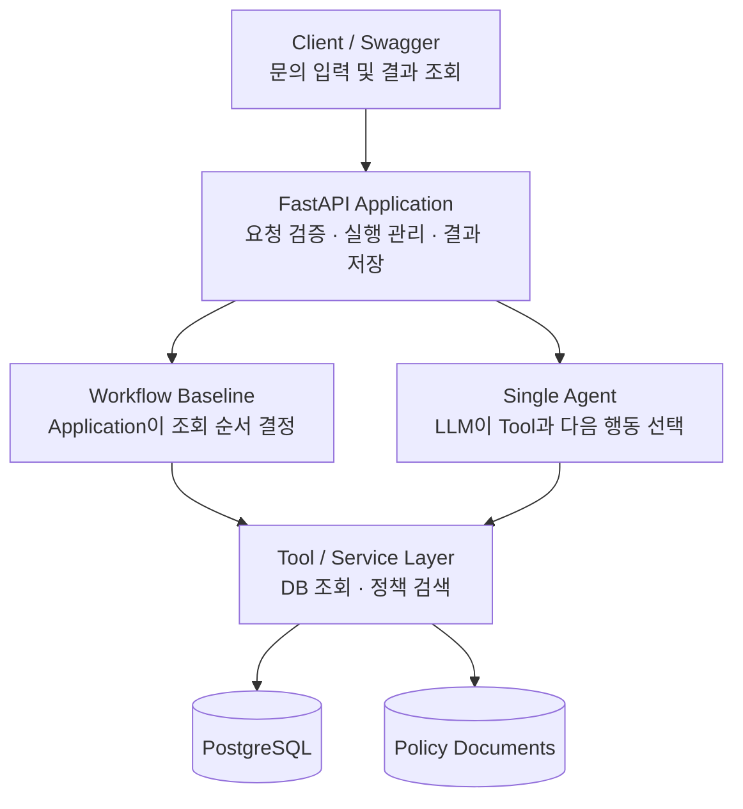

# SaaS Customer Support Agent — MVP 설계안 v0.1

## 1. 프로젝트 개요

**프로젝트 목표**

프로젝트의 핵심 목표는 Agent와 Workflow의 Trade-off를 실증적으로 평가하여, 어떤 문제와 조건에서 어떤 아키텍처가 유리한지 판단할 Evaluation 체계를 구축하는 것이다. 이를 위해 B2B SaaS 서비스의 고객 문의를 분석하고, 내부 데이터와 정책 문서를 활용해 문제의 원인을 진단하는 Backend + Support Agent와 Workflow Baseline을 구현한다.

단순한 질의응답 챗봇이 아니라, 고객의 상황에 따라 필요한 정보를 조회하고, 그 결과를 바탕으로 후속 작업을 선택하는 Agent를 구현한다.

**핵심 가설**

> 고객 지원 정책과 실제 고객 상황의 조합을 모두 정해진 Workflow로 구현하기는 어렵다. Agent가 중간 조회 결과를 바탕으로 필요한 정보를 동적으로 선택하면, 일부 복합 문의에서 고정 Workflow 대비 더 효율적인 문제 해결이 가능할 것이다.

이 가설은 프로젝트의 결론이 아니라 Evaluation을 통해 검증할 대상이다.

## 2. 도메인 및 MVP 범위

가상의 팀 협업 SaaS를 대상으로 한다.

실제 결제 시스템이나 협업 서비스를 전부 구현하지 않고, 고객 지원 진단에 필요한 Backend만 구현한다.

| 도메인 | 데이터 |
|---|---|
| User | 사용자 ID, 조직 ID, 역할 |
| Organization | 조직 ID, 팀원 수, 제한 정보 |
| Subscription | 플랜, 구독 상태, 만료일 |
| Payment | 결제 상태, 결제 시점 |
| Policy Document | 플랜 정책, 권한 정책, 문제 해결 가이드 |
| Support Request | 문의 내용, 진단 상태, 결과 |

초기 지원 범위는 구독 상태, 결제 상태, 사용자 권한, 팀원 초대 문제로 제한한다.

**MVP에서는 실제 계정 변경, 환불, 결제 수행을 제외한다.** 모든 Agent Tool은 읽기 전용으로 시작한다.

## 3. 시스템 구조



Workflow와 Agent는 동일한 Backend Service를 사용한다. 그래야 두 방식의 차이를 비교할 수 있고, 비즈니스 로직이 중복되지 않는다.

## 4. 핵심 기능

| 기능 | 구현 내용 | 우선순위 |
|---|---|---|
| 고객 문의 접수 | API로 문의 생성 | 필수 |
| 계정 및 조직 조회 | 고객과 조직 상태 확인 | 필수 |
| 결제 및 구독 조회 | 현재 결제·구독 상태 확인 | 필수 |
| 정책 검색 | 관련 정책 문서 검색 | 필수 |
| Agent 실행 | Tool 선택, 관찰, 후속 판단 | 필수 |
| 결과 저장 | 진단 결과 및 실행 기록 | 필수 |
| Workflow Baseline | 고정 조회 기반 진단 | 평가 전 필수 |
| Evaluation | 정확도·비용·지연시간 비교 | 필수 |
| 관리자 승인 및 상태 변경 | 승인 후 실제 Action 실행 | 후순위 |
| 대화형 UI | 채팅 화면 | 후순위 |

## 5. 초기 API

| Method | Endpoint | 역할 |
|---|---|---|
| `POST` | `/support/requests` | 문의 생성 |
| `POST` | `/support/requests/{id}/diagnose` | Workflow 또는 Agent 실행 |
| `GET` | `/support/requests/{id}` | 문의 상태 및 진단 결과 |
| `GET` | `/support/requests/{id}/traces` | 실행 단계와 Tool 호출 기록 |

초기에는 `diagnose` 요청을 동기적으로 처리해도 돼. 장시간 실행과 비동기 작업 관리는 실제 필요가 생기면 추가하는 것으로 하자.

## 6. Agent Tool

Tool은 크게 다섯 개로 시작하면 좋겠어.

```text
get_user(user_id)
get_organization(organization_id)
get_subscription(organization_id)
get_payment_history(organization_id)
search_policy(query)
```

Agent가 내부 데이터를 조회할 때는 Application이 인증된 고객과 조직의 접근 범위를 강제해야 해. LLM이 입력한 ID만 믿고 다른 고객의 데이터를 반환해서는 안 돼.

MCP는 초기 필수 구성 요소에서 제외하자. 기존 `tool-mcp-skill-lab`에서 이미 MCP 통합 경험이 있으므로, 이번에는 실제 문제 해결과 평가에 집중하는 게 낫겠어.

## 7. Evaluation 설계

단순히 Agent가 답변을 잘하는지 확인하는 것이 아니라, **고정 Workflow와 Agent 중 어떤 방식이 어떤 문제와 조건에서 더 적합한지** 비교한다. 핵심 산출물은 다음 두 가지다.

- **Evaluation Framework:** 공통 비교 조건에서 평가 케이스를 실행하고 진단 품질·정책 준수·호출 수·Token 사용량·비용·지연시간·실패를 측정·채점하는 재현 가능한 평가 체계.
- **Trade-off Analysis:** 측정 결과와 실패 사례를 바탕으로 문제 유형과 조건별 장단점 및 아키텍처 선택 근거를 정리한 분석.

개발은 Support Agent → Workflow Baseline → Evaluation Framework 및 Trade-off Analysis 순서로 진행한다. 현재 `workflow-baseline` Change는 첫 고정 단계 비교 대상과 관찰·검증 기반을 제공하며, 실제 평가 데이터셋·반복 실행·채점·통계 처리·데이터 동결은 후속 Evaluation Change에서 구현한다. 비교 결과는 해당 Baseline과 현재 Agent 구현 사이의 시스템 수준 Trade-off로 해석하며, 동적 Tool 선택만의 인과적 효과나 Workflow/Agent 전체의 일반적 우열로 확대하지 않는다.

평가 결과에 따라 자주 발생하는 고객 지원 케이스에 여러 Case-specific Workflow를 구성하고, LLM Router가 Workflow 또는 Agent를 선택하는 Hybrid Routing을 후속 확장으로 검토할 수 있다. Hybrid Architecture는 확정된 정답이나 현재 MVP의 필수 구현 항목이 아니다.

### 평가 대상

초기에는 30개의 테스트 케이스를 직접 구성한다.

| 유형 | 케이스 수 | 예시 |
|---|---:|---|
| 단순 정책 문의 | 5 | 플랜별 팀원 수 제한 |
| 단순 상태 확인 | 5 | 구독 활성화 여부 |
| 복합 문제 진단 | 15 | 결제·권한·조직 상태가 복합적으로 작용 |
| 정보 부족 / 해결 불가 | 5 | 추가 정보 요청 또는 담당자 이관 |

각 케이스에 정답 원인과 확인해야 할 정보, 기대되는 응답 행동을 정의한다.

### 주요 평가 지표

- **Diagnosis Accuracy:** 실제 문제 원인을 정확하게 진단했는가?
- **Tool Selection:** 필요한 Tool을 적절히 선택했는가?
- **Policy Compliance:** 정책에 어긋나는 설명이나 판단을 하지 않았는가?
- **Latency:** 응답까지 얼마나 걸렸는가?
- **Cost:** 요청당 LLM 토큰 사용량 및 추정 비용은 얼마인가?

정답이 복수이거나 추가 확인이 필요한 사례는 무조건 하나의 원인을 답하도록 강제하지 않고, 적절한 추가 질문이나 이관도 성공 행동으로 평가하자.

Evaluation은 처음부터 고도화하지 않아도 돼. 우선 정답 데이터와 자동 비교 가능한 지표를 확보하고, 어려운 판단은 수동 검토부터 시작하면 충분해.

## 8. 기술 스택

| 영역 | 초기 선택 |
|---|---|
| Language | Python 3.11+ |
| Backend | FastAPI, Pydantic v2 |
| Database | PostgreSQL, SQLAlchemy |
| Agent | OpenAI Responses API |
| Testing | pytest |
| Environment | uv, Docker Compose |
| Logging | Python logging + DB Trace |
| Frontend | Swagger UI로 시작 |
| Deployment | Docker 기반 배포 |

기존 `tool-mcp-skill-lab`의 코드를 무조건 이식하지는 말자.

개념과 설계 경험은 재사용하되, 이번 서비스에 실제로 필요한 부분만 구현하는 거야.

특히 처음부터 LangGraph나 복잡한 상태 관리 Framework를 추가할 필요는 없다고 생각해.

## 9. 구현 일정 및 Milestones

### Week 1 — Backend Foundation

DB 모델, Seed 데이터, 읽기 API, 테스트를 구축한다.

**완료 조건:** 고객·결제·구독·권한 정보를 API에서 조회 가능

### Week 2 — Agent MVP

Single Agent와 Tool을 연결하고 문의 진단 결과를 반환한다.

**완료 조건:** 복합 문의에 대한 E2E 진단 성공

### Week 3 — Baseline & Evaluation

LLM + Workflow Baseline과 평가 데이터셋을 만든다.

**완료 조건:** 두 접근법의 정확도, 비용, 지연시간 비교 가능

### Week 4 — 개선 및 안정화

평가 결과를 기반으로 Agent의 실패 원인을 분석하고 개선한다.

**완료 조건:** 개선 전후의 평가 결과 및 회귀 테스트 확보

### Week 5~6 — 배포 및 포트폴리오

실행 환경, 테스트, README, 데모, 아키텍처와 설계 결정 문서를 정리한다.

**완료 조건:** 채용 담당자가 실행 또는 시연 결과를 확인할 수 있는 프로젝트

이 일정은 목표이지, 6주를 전부 채워야 한다는 뜻은 아니야. 이력서에 넣을 만한 결과가 나오면 지원을 바로 병행하자.

## 10. Design Decisions

현시점에서 확정할 초기 설계 방향이야.

- **Agent는 문제 진단을 담당한다.** 실제 데이터 수정과 환불 같은 Action은 MVP 범위에서 제외한다.
- **Application은 실행과 데이터 접근을 통제한다.** Agent의 판단과 실제 정책 집행을 분리한다.
- **Single Agent로 시작한다.** Multi-Agent 및 복잡한 Orchestration은 사용하지 않는다.
- **Workflow와 Agent는 동일한 데이터를 사용한다.** 공정한 Evaluation을 위해 DB 상태와 정책 문서를 동일하게 유지한다.
- **정책 문서는 별도로 관리한다.** LLM Prompt 내부에 모든 정책을 하드코딩하지 않는다.
- **MCP는 초기 필수 요소가 아니다.** Tool 통합 방식보다 진단 성능과 E2E 서비스 완성에 집중한다.
- **Evaluation은 필수 구현 범위다.** 단순 시연만으로 프로젝트를 종료하지 않는다.

## 11. 지금은 하지 않을 것

기능이 계속 늘어나는 것을 막기 위해 명시적으로 제외하자.

- 실제 PG 결제 시스템 연동
- 전체 협업 SaaS 구현
- Redis, Celery 기반 분산 작업 시스템
- Long-running Agent 및 Resume
- Multi-Agent
- 복잡한 관리자 Dashboard
- 사용자별 장기 Memory
- 범용 Agent Framework 개발

필요성이 검증된 기능만 이후에 추가한다.

## 12. 바로 다음 작업

여기서부터는 공부가 아니라 구현으로 넘어가자.

첫 작업은 **Week 1의 Backend Foundation 구축**이야.

이때 가장 먼저 구현할 단위는 Agent가 아니라, 다음 데이터를 일관되게 조회할 수 있는 작은 Backend 시스템이야.

`User`, `Organization`, `Subscription`, `Payment`의 DB 스키마와 관계를 정의하고, 정상·오류 상태의 Seed 데이터를 구성하자. 그다음 Service Layer와 API, pytest 테스트를 작성하면 돼.

이 기반이 완성되면 같은 데이터로 Agent의 Tool을 만들 수 있고, 이후 Evaluation에도 그대로 활용할 수 있어.

**지금 프로젝트의 목적은 기술을 최대한 많이 사용하는 게 아니라, 문제 정의부터 실제 구현과 평가까지 완주한 경험을 증명하는 거야.**

이 설계안은 v0.1로 두고, 구현 중 필요성이 확인될 때 수정하자. 별도의 설계 질문 단계를 더 늘리지 않고 바로 첫 구현 작업으로 이어가면 좋겠어.
