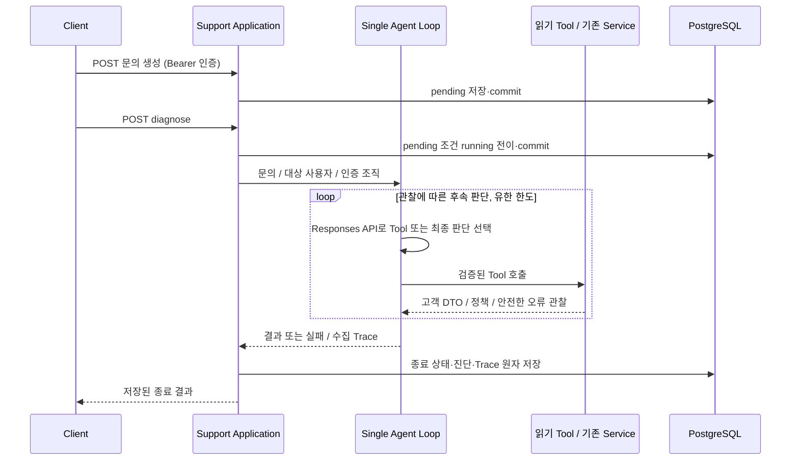

# Support Agent 설계 요약

이 문서는 두 번째 Change `support-agent`의 검토용 요약이다. 요구사항의 기준은 [OpenSpec proposal](../openspec/changes/support-agent/proposal.md)과 세 capability spec이며, 상세 구현 결정은 [design.md](../openspec/changes/support-agent/design.md), 구현 순서는 [tasks.md](../openspec/changes/support-agent/tasks.md)를 따른다. support-agent 구현은 이 경계를 따른다. 실행 방법과 상태·오류 해석은 [README](../README.md#문의와-동기-agent-진단)를 참고한다.

## 1. Change 개요와 범위

기존 Backend 조회 Service를 재사용해 문의를 실제 상태와 정책으로 진단하는 Single Agent MVP를 만든다. 생성·동기 diagnose·결과·Trace의 네 API, 세 저장 모델, Responses Loop, 다섯 읽기 Tool, 단순 정책 검색과 자동 테스트가 범위다.

실제 결제·환불·계정 변경, Workflow Baseline/Evaluation 실행기, Multi-Agent/MCP/LangGraph/Redis/Celery 및 범용 Agent Framework는 제외한다. 기존 `customer-data`와 `customer-read-access` 명세를 변경하지 않는다.

## 2. Agent 실행 흐름 및 Architecture

Router는 HTTP 연결, Support Service는 인증 범위·실행 상태·결과 검증·트랜잭션, Loop는 모델 호출·종료 제한을 맡는다. Tool 결과는 call_id와 함께 다음 Responses 입력으로 전달하며 조회 순서를 고정하지 않는다. API 상태는 pending → running → completed/failed다.

## 3. Tool과 기존 Service의 연결 방식

| Tool | 연결 | 권한 통제 |
|---|---|---|
| get_user | 기존 `customer.get_user` | 인증된 조직의 사용자 |
| get_organization | 기존 `customer.get_organization` | 인증된 조직 |
| get_subscription | 기존 `customer.get_subscription` | 인증된 조직 |
| get_payment_history | 기존 `customer.get_payment_history` | 인증된 조직, 기존 정렬 |
| search_policy | 새 정책 검색 Service | 고객 데이터 없는 공통 정책 |

얇은 어댑터가 UUID/검색어·추가 인자를 검증하고 Session/CallerContext를 주입하여 DTO를 관찰로 직렬화한다. 기존 Service의 조회·조직 검사 로직은 재사용한다. 정책은 별도 JSON 문서에서 키워드 점수와 고정 동점 정렬로 최대 3개를 반환하고, 조회 당시 문서 내용을 Trace에 남긴다.

## 4. 문의·진단·Trace Data Model

| 모델 | 책임 | 핵심 무결성 |
|---|---|---|
| SupportRequest | 생성자·조직·내용·상태·UTC 실행 시각·오류 | User/Organization FK, 상태·내용 제약 |
| Diagnosis | outcome·요약·원인·권장 행동·관찰 근거 | 문의당 하나, outcome 제약 |
| AgentTrace | 실행 순서·LLM 메타데이터·Tool 입력/관찰·오류·소요시간 | 문의/sequence 유일성, 문의 FK |

근거는 같은 실행의 tool_result sequence와 nullable 정책 ID를 참조한다. Application이 참조와 outcome별 필수 내용을 검사한다. 모든 ORM은 공통 Base를 사용하고 모델 패키지에서 명시적으로 등록하여 DB CLI와 테스트 초기화가 같은 일곱 테이블을 생성한다. 상세 필드 계약은 [support-requests spec](../openspec/changes/support-agent/specs/support-requests/spec.md)을 따른다.

## 5. 인증·권한 및 트랜잭션 경계

CallerContext는 기존 Bearer 인증과 DB User로 생성한다. LLM 인자나 조직 헤더는 인증 범위를 결정하지 않는다. 같은 조직의 owner/admin/member는 문의와 Trace에 같은 접근을 갖고, 다른 조직과 없는 문의는 동일 404다. 기본 진단 대상은 문의 생성자이며 실행자와 구분한다.

Application이 기존 주입 Session에서 문의 생성, running claim, 종료 저장을 각각 commit한다. 인증 조회로 autobegin이 시작된 사실을 고려하고 조회 Service/Tool에는 commit을 추가하지 않는다. 종료 상태·진단·전체 Trace는 하나의 트랜잭션으로 저장하며 실패하면 전체 rollback한다. DB 오류는 503이고 rollback 후 실패 상태/Trace 저장을 한 번 시도한다.

실행 중 조회 transaction은 LLM 대기 중 유지될 수 있다. 종료 전 Trace는 메모리에만 있어 실행 중 조회는 빈 배열일 수 있다. 지속 DB 장애나 프로세스 종료 시 running만 남을 수 있으며 자동 복구는 이번 범위에 포함하지 않는다. 구체적 소유권은 [design D6](../openspec/changes/support-agent/design.md#d6-application의-트랜잭션-소유권)을 참고한다.

## 6. Agent 종료 조건과 실패 처리

| 조건 | 처리 |
|---|---|
| 유효한 diagnosed/needs_information/escalate | completed, 진단·근거 저장 |
| not_found, 잘못된 Tool 인자, unknown_tool | 안전한 관찰로 후속 판단, 한도에 포함 |
| 빈 결제/정책 결과, 만료·실패 결제 | 업무 관찰로 처리 |
| LLM 오류·거부·잘못된 최종 출력·치명적 Tool 오류 | failed와 오류 코드·Trace 저장 |
| 호출/시간 한도 초과 | 추가 행동 중단, failed |
| DB 조회/저장 실패 | rollback, 가능한 실패 기록, HTTP 503 |

기본 한도는 모델 호출 8회·Tool 시도 16회·Agent 실행 60초이며 설정 가능하다. SDK 숨은 재시도를 끄고 남은 시간에 맞춘 요청/DB timeout을 적용한다. 정상 저장된 기술 실패는 HTTP 200의 failed로 전달한다. completed 재호출은 기존 결과를 반환하고 running/failed 재호출은 409다.

## 7. 주요 Design Decisions

- **인증·실행 통제는 Application:** 조회 대상 선택이 인증 범위 선택으로 이어지지 않게 한다.
- **기존 Service 직접 재사용:** 고객 조회 규칙과 DTO를 하나로 유지하며 향후 Baseline도 같은 함수를 사용할 수 있다.
- **한 Session과 명시적 commit:** 현재 주입 구조를 유지하면서 저장 소유권을 분명히 한다. 장시간 연결 점유는 알려진 비용이다.
- **작은 공통 코드 분리:** Base와 두 Router가 쓰는 인증/Session 의존성만 분리하고 명시적 모델 등록을 연결한다.
- **실제 관찰 참조 검증:** 모델이 만든 정책 ID/Trace ID를 그대로 신뢰하지 않는다. 진단 의미의 정확성은 별도 검증이 필요하다.
- **정책은 별도 문서:** member_limit, 역할 및 저장 상태에 맞는 최소 정책을 사용하며 플랜별 고정 한도나 환불 조건을 임의로 추가하지 않는다.
- **Responses 맥락은 실행 메모리:** 반환 항목과 Tool 결과를 누적하고 내부 reasoning은 DB Trace에 저장하지 않는다. SDK 연결의 근거는 [공식 Function calling 문서](https://developers.openai.com/api/docs/guides/function-calling)다.

## 8. Acceptance Criteria 및 검토할 사항

완료 판단은 다음을 실제 테스트로 확인하는 것이다.

- 고정 복합 문의를 생성→진단→결과/Trace 조회까지 실행하고 관찰이 후속 모델 입력에 전달된다.
- 역할·팀원 제한·구독/결제 문제·부재·정보 부족/이관과 주요 기술 실패를 재현한다.
- HTTP와 Tool 양쪽의 조직 격리, 고객 데이터 읽기 전용성, 중복 실행 차단을 유지한다.
- 독립 PostgreSQL 연결로 commit 지속성·종료 저장 원자성·rollback을 확인하고 모든 모델의 초기화를 검증한다.
- 기존 Backend 테스트와 신규 테스트가 통과한다. Responses fake 통합 검증과 실제 모델 수동 smoke 결과를 구분한다.

구현 전 검토할 결정은 동일 조직 문의/Trace 공유, 한 문의당 한 번 실행, Agent 실패의 HTTP 200 계약, LLM 대기 중 transaction 유지, running 잔존 허용이다. 정책의 초대 권한·구독 조건도 가상 서비스의 MVP 규칙으로 검토한다. 이들은 미정 항목이 아니라 이번 명세에 채택한 결정이다.

환경 확인 사항은 OPENAI_MODEL/Key·SDK 기능 지원과 개발 DB 설정이다. 실제 모델의 원인 판단 품질, 지연시간/토큰 사용, 실제 데이터 도입 시 열람·보존 요구는 추가 검토가 필요하다. 자동 테스트와 실제 모델 Smoke Test를 구분하여 보고하며, 자동 테스트 통과만으로 실제 모델 진단 품질을 입증하지 않는다.
