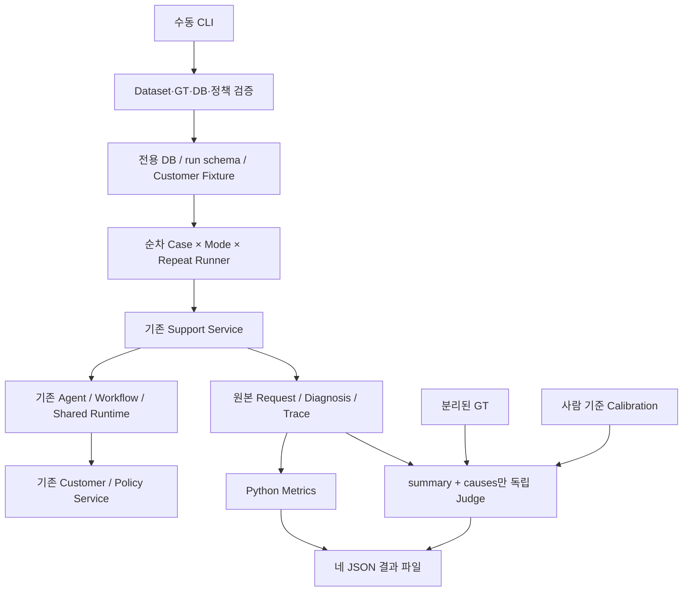

# Design

## Context

변경 목적과 범위는 [Proposal](proposal.md), 외부 동작은 [Spec](specs/diagnosis-evaluation/spec.md)을 따른다. 아래는 파일 정적 검토 결과이며 이번 단계에서 DB나 테스트로 실행 검증한 결과가 아니다. 현재 활성 Change는 없었고 관련 구현 Change는 archive에 있다.

| 검토 대상 | 현재 코드 계약과 설계 영향 |
|---|---|
| `app/schemas/support.py` | `DiagnosisDTO`는 outcome/summary/causes/next_actions/evidence. outcome은 diagnosed/needs_information/escalate. diagnosed는 원인·근거, 나머지는 next_actions가 필수다. 원인 문자열을 GT ID로 바꾸거나 필드를 추가하지 않는다. |
| `app/api/support.py`, `app/services/support.py` | 생성은 content만 허용, 조직·생성자는 CallerContext에서 결정한다. pending→running→completed/failed, 실행 방식은 running claim과 함께 확정한다. 동일 모드 completed 재호출은 결과 재사용, 다른 모드 또는 running/failed는 conflict다. 따라서 모든 측정은 새 문의를 사용한다. |
| 실행 성공 계약 | needs_information/escalate도 completed다. 처리된 실행 실패는 HTTP 200의 failed이며 DB 실패는 HTTP 503이다. Runner는 HTTP 성공 코드나 diagnosed 여부를 Execution Success로 사용하지 않는다. |
| `validate_diagnosis` | 동일 실행 tool_result의 observation 참조, 검색에서 실제 받은 정책 ID, diagnosed의 최소 성공 관찰을 검사한다. 모든 Evidence 문장의 의미나 원인 사실을 증명하는 검사는 아니다. 기존 검증을 유지하고 의미 정확성만 별도 채점한다. |
| `TraceDTO`, `app/diagnosis/llm.py` | event_type, duration_ms, usage, model, error_code 등이 이미 있다. LLM 예외도 llm_response 1건을 기록하지만 usage/model이 없을 수 있다. usage는 input/output/total만 남기고 캐시 상세는 보존하지 않는다. |
| `app/diagnosis/{runtime,llm,tools}.py` | Budget·LLM 호출·관찰 Tool 실행·Trace는 Shared Runtime이다. Agent와 Workflow가 이를 재사용하므로 새 계측을 Loop 내부에 넣지 않는다. 종료 전 Trace는 메모리에만 있어 지속 DB 장애/프로세스 종료 시 유실될 수 있다. |
| `app/agent/loop.py`, `app/workflow/runner.py` | Agent는 동적 Tool 선택과 순차 처리, 기본 모델 8회/Tool 16회다. Workflow는 user→organization→subscription→payment→정책 3검색 후 최대 LLM 1회다. 같은 모델과 기본 60초 Budget을 사용해도 Context·조회 범위·호출 수 차이는 보존한다. |
| `app/services/customer.py`, `app/models/customer.py` | member_count는 조직별 User COUNT이며 ORM 컬럼이 아니다. 실효 한도는 Organization.member_limit, 구독은 상태와 nullable expires_at을 그대로 반환한다. Service는 만료나 초대 성공을 계산하지 않는다. 모든 역할은 같은 조직 읽기/문의 실행이 가능하다. |
| `app/services/policy.py`, `policies/*.json` | plans/permissions/troubleshooting 세 문서를 고정 순서 로드한다. casefold·공백 토큰의 부분문자열 점수, 점수 내림차순/document_id 오름차순, 상위 3개다. Vector DB나 정책 주입 우회가 필요 없다. |
| `app/seed.py` | 상대 날짜·고정 ID upsert를 재사용 패턴으로 참고한다. 기존 4개 조직은 C01~C05와 다르고 C05 전용 member도 없으므로 그대로 정답 Fixture로 삼지 않는다. |
| `app/db.py`, `tests/conftest.py` | PostgreSQL 엔진·개발/테스트 DB 이름 분리, 테스트 세션별 schema/search_path와 테스트별 savepoint 패턴이 있다. durable 테스트의 전체 delete와 schema teardown은 테스트 소유 범위의 기능이며 Evaluation 정리 코드로 이식하지 않는다. |
| `scripts/workflow_smoke.py` | 개발 DB 준비·Seed 갱신·Backend 시작을 수행하는 수동 smoke다. Evaluation의 격리·동일 기준·반복·GT/집계 요구를 충족하지 않으므로 실행기를 상속하지 않는다. 안전한 결과 보존 방식만 참고한다. |

문서 차이: `docs/mvp.md`는 30개 Case와 Tool Selection/Policy Compliance까지 제안하지만 이번 사용자 범위는 초대 실패 5개와 일곱 Metrics다. `docs/support-agent-design.md`는 support-agent 시점 요약이라 execution_mode 및 이후 Shared Runtime 구성을 모두 설명하지 않는다. 최신 main spec 6개와 위 코드에서 요청된 핵심 계약의 충돌은 발견하지 못했다. `customer-data`의 member_count는 조회 필드이며 실제 저장 컬럼으로 해석하지 않는다. 아카이브된 `share-diagnosis-runtime`은 공통 구현을 분리한 변경으로 취급한다.

## Goals / Non-Goals

**Goals:** 평가 코드를 Application 바깥에 두고, 같은 업무 상태의 진단과 재채점·집계를 분리한다. Fixture/GT 오류, 실행 실패, 채점 실패를 구별하고 작은 표본에서도 누락·분모가 드러나는 결과를 만든다.

**Non-Goals:** 진단 구조·Prompt·정책·비즈니스 규칙 변경, Runtime 재구현, HTTP 네트워크 성능 평가, 자동 DB 정리/복구, 실험 재개·진단 재시도, 통계적 유의성 검정은 하지 않는다. Proposal의 제외 범위를 유지한다.

## Decisions

### D1. 작은 독립 Evaluation 패키지와 Support Service 직접 호출

예정 파일은 `evaluation/{dataset,fixtures,runner,metrics,judge,results}.py`, `evaluation/data/{invite_cases,invite_gt,judge_calibration,pricing}.json`, `scripts/evaluate.py`다. 필요한 입출력 모델은 해당 모듈에 둔다. 공통 Engine·ORM·Settings와 기존 Service를 사용하고 별도 Repository/Plugin/Metric Registry를 만들지 않는다.



Fixture의 requester UUID로 `customer.authenticate`를 호출하여 DB에서 CallerContext를 만든다. 임의 role/context를 조립하지 않는다. 같은 사용자가 생성·진단하고 기존 Support의 생성·진단·결과·Trace 함수를 호출한다. GT는 Customer DB와 RequestCreate에 넣지 않고 Judge/사전 검증에만 사용한다. API와 같은 Application 경계를 재사용하지만 HTTP 인증·전송 지연까지 재는 실험은 아니다. HTTP Runner는 기존 API를 재사용할 수 있으나 Backend 설정·인증 토큰·원격 DB 검증이 더 필요하여 이 MVP에서는 선택하지 않는다. HTTP 조직 경계는 기존 회귀 테스트로 유지한다.

### D2. 정책에서 도출한 Fixture와 GT

`invite_cases.json`은 dataset_version, 공통 content, Case별 requester_role, member_limit, users, subscription(plan/status/expires_offset_days), payments를 갖는다. User 배열이 인원 수의 유일한 구성 원천이다. `invite_gt.json`은 Case별 기대 outcome·원인·제외 원인·필수 사실과 근거 policy_document_id를 갖는다. 원인 ID는 평가 내부 식별자이며 모델 출력에 강제하지 않는다.

모든 Case에 요청자 1명과 보조 owner 1명, plan=pro, 성공 결제 1건(created_at/paid_at=reference_time−60일)을 둔다. 이는 결제 실패라는 추가 변수를 없애고 구독 만료와 결제 이력을 독립된 사실로 유지하기 위한 구성이다. 조직명은 `Evaluation organization 1`처럼 정답을 드러내지 않고 UUID는 run+Case+레코드 키의 결정적 namespace로 생성한다. Case ID는 평가 파일에만 남기며 모델에는 포함하지 않는다.

| Case | 요청자 | User 수 / member_limit | 구독 status / expires_at | expected_outcome | primary_causes | required_facts와 excluded_causes |
|---|---|---|---|---|---|---|
| C01 | member | 2 / 3 | active / +30일 | diagnosed | permission_denied | member의 초대 권한 부재. 구독 문제·한도 도달·결제 실패 제외. |
| C02 | admin | 2 / 2 | active / +30일 | diagnosed | member_limit_reached | 현 인원이 실효 한도에 도달. 권한 부족·구독 문제·결제 실패 제외. |
| C03 | admin | 2 / 3 | expired / −30일 | diagnosed | subscription_expired | 구독이 만료되어 초대 조건 불충족. 권한 부족·한도 도달·결제 실패 제외. |
| C04 | admin | 2 / 3 | active / +30일 | needs_information | [] | 권한·활성 미만료 구독·인원 여유가 정상이고 현재 정보로 확정 불가. 세 조건 위반·결제 실패·확정된 서비스 장애 제외. |
| C05 | member | 2 / 2 | expired / −30일 | diagnosed | permission_denied, member_limit_reached, subscription_expired | 세 위반을 모두 설명. 결제 실패·근거 없는 별도 장애 제외. |

`permissions`는 owner/admin 권한과 active·미만료·인원 여유의 AND 조건을 명시한다. `plans`는 플랜 고정값 대신 member_limit을 사용한다. `troubleshooting`은 expired 및 상태/만료일 불일치의 구분과 결제만으로 구독 상태를 덮어쓰지 않을 것을 명시한다. 이에 따라 C03/C05는 expired와 과거 expires_at을 일치시켜 정보 부족 Case로 변하지 않게 한다. C05의 expired status와 과거 날짜는 하나의 만료 원인에 대한 두 사실이며 별개 원인으로 중복 계산하지 않는다.

C04는 원인 미확정이며 현재 문의만으로 지원 범위 밖임을 알 수 없으므로 needs_information을 채택한다. escalate는 기존 계약에서 유효하지만 이 Case의 expected_outcome과는 다르다. 도움 요청/이관 권고 자체는 잘못된 원인이 아니다. required_facts는 원인의 의미와 평가 맥락을 명확히 하는 GT 정보이며 Diagnosis에 모든 내용을 명시하도록 요구하지 않는다. excluded_causes는 대표 오답이며 목록 밖의 근거 없는 원인도 오답이다. 일반적인 가능성을 질문하는 것과 실제 실패 원인으로 단정하는 것을 구분한다.

대안인 새 초대 판정 Service나 문자열 일치 정답표는 비즈니스 규칙 중복과 자연어 오채점을 유발한다. 대신 고정된 5개 Fixture 조건을 Python으로 검증하고 GT 의미·정책 근거는 구현 검토 시 사람이 확인한다. 자동 검사로 모든 자연어 GT 오류를 탐지한다고 주장하지 않는다.

### D3. 전용 DB와 실행별 schema, 명시적 기준 시각

새 `EVALUATION_DATABASE_URL`은 필수다. 개발/테스트 URL도 격리 검사 용도로 필수이며 접속 없이 DB 이름을 파싱한다. PostgreSQL·비어 있지 않은 DB 이름·개발/테스트와 다른 이름을 확인하고 실제 연결의 current_database가 선택한 이름과 일치하는지도 확인한다. 호스트 별칭이 달라도 DB 이름이 같으면 거부하는 기존 테스트 정책을 따른다. URL 원문이나 password는 로그/manifest에 저장하지 않는다.

운영자가 별도 Evaluation DB를 미리 생성한다. Runner는 생성한 run_id로 새 `eval_<uuid hex>` schema를 만들고 각 연결 search_path를 그 schema로 제한한 뒤 `Base.metadata.create_all`로 기존 일곱 테이블을 구성한다. 식별자는 내부 UUID에서만 생성한다. 기존 schema가 있으면 중단하고 다른 schema의 기존 테이블로 fallback하지 않는다. DB 생성·migration·drop/delete/truncate·기존 schema 재활용은 자동 수행하지 않는다. 정상/실패 schema를 모두 보존하며 수동 정리 대상 이름은 manifest에 기록한다.

자동 테스트의 DB 작업은 기존 격리 검사를 통과한 TEST_DATABASE_URL의 테스트 소유 schema/Engine을 하위 Fixture·Runner 함수에 주입한다. 실제 Evaluation DB를 테스트 대상으로 요구하지 않는다. CLI 진입점의 세 DB 격리·실제 DB 확인은 별도 Fake 연결 테스트로 검증하고, 이 테스트 주입 경계를 실제 CLI의 검증 우회 옵션으로 노출하지 않는다.

시작 시 UTC reference_time을 정하고 상대 날짜를 구체화한다. 실제 실행의 `now`는 정상 UTC를 사용하여 DB/Trace 시각 의미를 유지하고 각 진단의 기준 UTC는 기존 Runtime이 설정한다. 만료일은 ±30일로 넉넉하게 분리하며 각 실행 직전 실제 UTC에서도 조건이 유지되는지 검사한다. 테스트에는 기존 now/clock 주입을 사용한다. 기준 시각을 고정하여 Request 시각을 모두 같은 값으로 만드는 방식은 Latency 해석을 흐리므로 실제 평가에는 쓰지 않는다.

Fixture는 한 번의 고객 데이터 트랜잭션으로 insert한다. authenticate 및 기존 고객 조회로 역할·조직 관계·User COUNT·한도·구독·결제의 실제 DTO를 검증한다. 매 실행 전후 고객 snapshot/hash와 정책 hash를 비교한다. Support 데이터 증가만 허용한다. 시작 전 Dataset/GT의 5개 ID·schema·정책 근거·조건별 원인 매핑을 검증한다. 승인된 GT hash도 manifest에 기록한다. 불일치 발견 시 run을 invalid_environment로 끝내고 완료분은 보존하되 최종 비교는 무효로 표시한다.

정책 버전은 세 파일 각각의 SHA-256과 경로·document_id, 정렬된 집합 hash로 식별하고 정확한 비밀 없는 문서 snapshot을 manifest에 보존한다. 새 검색 방식이나 모델 전용 정책 주입은 추가하지 않는다. 공유 public 테이블에 평가 조직만 추가하는 대안보다 run schema는 불필요한 레코드·과거 결과의 혼입을 줄이며 저장 공간/수동 정리 비용을 수용한다.

### D4. 순차 실행과 원본 우선 저장

실행 계획은 `for repeat in 1..N → C01..C05 → ordered_modes`로 고정한다. N은 1 또는 5, 홀수 repeat는 agent/workflow, 짝수는 workflow/agent다. 5회 중 시작 모드가 3:2인 편향은 manifest에 드러내고 임의 randomization을 추가하지 않는다.

각 실행은 preflight→인증→새 문의 생성→`diagnose_request(mode=...)` 1회→저장 결과·Trace 조회→원본 JSON 보존으로 진행한다. 실행별 Session을 사용하고 기존 Service의 commit/rollback 소유권을 따른다. 서비스에 같은 모델·공통 설정·동일한 60초 Budget을 전달한다. Agent 전용 8회/16회 한도와 Workflow 7회 조회/1회 LLM은 원래 구조의 일부로 기록한다. Prompt 원문/코드 revision hash, 설정 모델 및 Trace의 실제 응답 모델을 구분해 기록한다. 모델 alias의 실제 버전 차이가 발견되면 결과의 비교 한계로 표시한다.

Judge는 모든 진단 수집 후 별도 단계로 실행하여 실행 간 대기와 진단 Latency에 섞이지 않게 한다. 처리된 진단 실패는 다음 실행을 진행한다. 준비/Fixture/GT/정책 오류는 전체 중단한다. 진단 중 DB 오류는 해당 실행 실패 영역이며 저장 복구 조회에서 completed가 확인되면 성공으로 보존한다. DB가 계속 불가하면 해당 실행을 incomplete로 남기고 후속 준비도 실패하므로 run을 중단한다. 파일 저장 실패·사용자 중단도 신규 호출을 중단하고 이미 보존한 원본을 유지한다. 진단 재시도/자동 재개는 제공하지 않는다.

### D5. Python에서 계산할 일곱 Metrics

| Metric | 정의·불완전 데이터 처리 |
|---|---|
| Diagnosis Correctness | 아래 D6의 최종 correct/incorrect/review_required/pending/not_applicable. 비율은 correct/(correct+incorrect), 판정 coverage는 분모를 해석할 상태별 개수로 제공한다. 별도 품질 지표를 추가하지 않는다. |
| Execution Success | completed + 유효 Diagnosis + 기존 참조 검증 통과면 true. 원인이 틀려도 실행은 성공이다. failed/시작 후 nonterminal/미확인은 false. 준비 중 미시작은 null. |
| End-to-end Latency | 문의 생성 Service 호출 직전부터 diagnose 반환/예외까지 monotonic elapsed ms. 두 호출 사이 Runner dispatch와 생성/시작/종료 저장을 포함한다. 인증/preflight·사후 조회·Judge·결과 파일 I/O는 제외한다. HTTP E2E가 아닌 Service E2E로 manifest에 boundary를 기록한다. |
| Input / Output / Total Tokens | llm_response usage를 필드별 합산한다. 완전한 Trace의 모든 호출에 해당 필드가 있을 때만 완전 합계를 제공한다. 부분 합계 observed와 누락 호출 수를 별도 보존한다. total은 공급자 total을 사용하며 input+output으로 누락을 채우지 않는다. |
| LLM Calls | 완전한 Trace의 llm_response 수. 응답 거부·통신 오류 시도도 포함한다. 수집 Trace가 불완전하면 complete count=null, observed count만 제공한다. |
| Tool Calls | 완전한 Trace의 tool_result 수. 오류/unknown_tool/잘못된 인자도 포함한다. Workflow의 고정 조회·정책 검색도 같은 방식으로 센다. 조회 전 한도로 차단된 미실행 요청은 포함하지 않는다. |
| Estimated Cost | 호출별 응답 model과 입력/출력 usage를 pricing에 매핑하여 `(input × input_rate + output × output_rate) / 1e6` USD를 합한다. 완전 합계/관측 부분 합계/누락 이유를 구분한다. |

Trace가 완전하고 LLM 0회가 확인되면 Tokens/Cost/LLM Calls는 0이다. null usage, Trace 유실, 알 수 없는 응답 모델이나 가격은 0이 아니다. incomplete 실행의 관찰 시간은 censored=true로 남기고 최종 완료 시간 평균에는 넣지 않는다. 성공·처리된 실패의 최종 Latency는 모두 전체 실행 집계에 포함한다. Request.started_at/finished_at과 Trace.duration_ms는 원본으로 유지하지만 단계 시간 합을 E2E로 사용하지 않는다. 기존 Budget은 전체 Service/HTTP 지연의 엄격한 60초 상한이 아니다.

Trace 완전성은 저장된 terminal 문의, 연속 sequence, 시작 및 상태에 맞는 종료 이벤트와 기존 관찰 참조 일관성으로 판단한다. 빈/유실 Trace를 0회 실행으로 간주하지 않는다. 이 구조 검사도 의미 품질이나 독립 Safety 지표로 확장하지 않는다.

`pricing.json`은 pricing_version/as_of/currency=USD, 응답 모델별 input/output USD per million tokens, 출처와 적용 가정을 담는다. 실제 단가를 이 제안에서 임의 확정하지 않고 수동 실행 전에 사람이 채운다. 계산은 Decimal을 사용하고 출력 정밀도를 명시한다. 캐시/할인/계약 요금은 현재 Trace로 확인할 수 없어 입력 전량에 기본 단가를 적용한 추정이며 청구액이 아니다. 기존 Runtime에 캐시 사용량 수집을 추가하지 않는다. Judge usage/cost는 별도 overhead로만 보존하고 진단 Cost/LLM Calls에 합치지 않는다.

### D6. 의미 Judge와 deterministic outcome 검사

Judge는 별도 Responses 요청과 별도 JSON 출력 schema를 사용한다. 기존 `call_model`은 Diagnosis 출력 schema를 강제하므로 Judge 어댑터에서 기존 SDK 사용 패턴을 참고하되 Diagnosis Runtime을 범용화하지 않는다. 기존 의존성만 사용하고 Fake create 함수를 주입할 수 있게 한다. 진단과 Judge는 같은 모델일 필요가 없으며 Judge 모델·Prompt/Rubric·GT·출력 schema 버전을 기록한다. SDK 재시도는 0, 요청 timeout은 유한 값(기본 20초), 기술 실패의 자동 재시도는 없다.

Judge 입력은 GT(expected_outcome/primary_causes/excluded_causes/required_facts)와 `{summary, causes}`뿐이다. 실행 ID·Case ID·모드·Trace·다른 답변·성능·next_actions·evidence·실제 outcome은 전달하지 않는다. 로컬에서 opaque judgment_id와 execution_id를 연결한다. 각 결과를 독립 요청하며 이전 응답을 재사용하지 않는다. 입력은 채점 대상 데이터로 취급하여 Diagnosis 문장에 있는 채점 지시를 따르지 않게 한다. 문체로 구조를 추론할 가능성까지 없애는 것은 보장하지 않는다.

Diagnosis Correctness는 실제 원인 식별 정확성을 평가한다. 의미 Rubric은 primary_causes의 필수 원인을 모두 식별하고 잘못된 부가 원인을 주장하지 않아야 correct이며, 필수 원인 누락이나 잘못된 추가 원인은 incorrect다. 자연어 동의 표현을 허용한다. required_facts는 원인의 의미와 평가 맥락을 명확히 하는 GT 정보로 사용하며 모든 내용을 Diagnosis에 문자 그대로 또는 빠짐없이 명시하도록 강제하지 않는다. 사실의 생략만으로 incorrect로 판정하지 않되, 필수 사실에 반하는 잘못된 주장은 incorrect로 판정할 수 있다. C04는 현재 정보로 원인을 확정할 수 없음을 표현하고 근거 없는 원인을 단정하지 않아야 하며 정상 조건을 모두 나열할 필요는 없다. 원인 언급은 summary와 causes의 합집합으로 보고 두 필드 간 모순도 평가한다. 설명의 의미를 확정할 수 없을 때만 review_required다. next_actions/evidence의 의미 품질은 이번 Judge 대상이 아니며 Groundedness를 독립 평가 지표로 추가하지 않는다.

Judge 출력은 `semantic_verdict: correct|incorrect|review_required`, `reason`, `missing_causes`, `missing_facts`, `incorrect_causes`다. missing_facts는 검토 참고용으로 유지하고 값이 있다는 이유만으로 incorrect를 강제하지 않는다. 필수 사실에 반하는 주장을 오답 근거로 삼으면 reason에 해당 주장과 GT의 모순을 기록한다. Python은 `outcome_match`를 계산한다. 최종 판정 우선순위는 다음과 같다.

1. 유효한 Diagnosis 부재: `judge_status=not_applicable`, `final_verdict=not_applicable`.
2. Judge 통신/형식 오류: `judge_status=judge_failed`, `semantic_verdict=null`, `final_verdict=pending`. outcome 불일치가 관찰되어도 기술 실패 상태를 보존한다.
3. Judge 응답 유효: outcome 불일치면 final=incorrect, 일치하면 semantic_verdict를 final에 반영한다. `outcome_match`, 의미 판정과 이유를 함께 보존한다.

이는 기존 Diagnosis의 outcome을 무시하지 않으면서 `summary + causes` 의미 비교와 명확히 분리하기 위한 결정이다. Execution Success는 이 판정과 무관하다. 단어 포함 검사나 Agent/Workflow 쌍 비교 Judge는 의미 오판·모드/위치 편향 때문에 선택하지 않는다.

### D7. 사람 Calibration과 분모가 보이는 집계

별도 `judge_calibration.json`에 약 15개 대표 비식별 예제를 초기 Calibration Set으로 둔다. 다섯 Case·세 semantic label과 동의 표현, 필수 사실의 생략과 모순의 구분, 단일/복합 원인 누락, 맞는 주원인+잘못된 부가 원인, C04 장애 단정과 추가 질문의 구분을 포함한다. 사람이 Judge 실행 전에 GT와 예제를 보고 label/reason/검토 버전을 확정한다. LLM이 만든 label을 사람 판정으로 기록하지 않는다. 기준 답안이 미완성인 상태도 파일로 표현하며 uncalibrated로 처리한다.

Human Label과 Judge의 의미 판정 일치율 90% 이상을 초기 MVP의 검토 목표로 둔다. 전체 확정 Human Label 수를 분모로 사용하여 Judge 실패를 성공한 표본에서 조용히 제외하지 않는다. 일치율의 분자/분모, 혼동표, 실패 건수, 항목별 사람/Judge 판정과 불일치 원문·버전을 저장한다. 필수 원인 누락·잘못된 부가 원인·C04의 근거 없는 원인 단정을 correct로 판정하는 핵심 오류(false-correct)를 확인한다.

이 초기 Set에서 calibrated로 표시하는 조건은 대표 예제와 Human Label 검토 완료, Judge 기술 실패 없음, 일치율 검토 목표 충족, 지정 핵심 오답의 false-correct 0이다. 이는 해당 Set과 같은 Judge 모델·Prompt·Rubric·GT 버전에 한정된 검토 통과 상태이며 일반적인 Judge 정확성 90% 이상이나 실제 평가 품질을 보장하지 않는다. 버전이 바뀌면 이전 Calibration은 적용하지 않는다. 기준 미달/미완료에는 uncalibrated로 표시하고 원본 실행·잠정 채점은 보존하되 품질 결론을 확정하지 않는다. 자동 테스트는 사람 판정 절차를 대신하지 않는다.

summary는 `case_id × mode`와 mode 전체로 나누고 진단 결과가 있는 실행의 final 상태별 개수, 시작/미시작/성공/실패/incomplete/환경 오류 수를 보존한다. Correctness 분모는 correct+incorrect, Execution Success 분모는 진단 Service 호출이 시작된 실행 수다. 문의 생성 실패는 pre-execution 환경 오류이며 측정 elapsed는 원본에 남기되 실행 성공/진단 비교 분모에 넣지 않는다. 판정 가능한 표본이 없으면 비율은 null이다.

수치 Metrics는 `all_started`와 `successful` 두 population에서 count/mean/median/min/max를 제공한다. Token/Calls/Cost는 완전한 값만 주 통계에 쓰고 missing_count·부분 관측 합계를 별도 표시한다. 완전성 부족한 전체 비용/토큰 총합은 null이며 알려진 부분은 observed_sum이다. Latency는 terminal 표본만 최종 지연 통계에 쓰고 censored_count를 별도 표시한다. 전체 시작 실행 중 실패를 일괄 제외하지 않는다. 이 상태 개수는 해석용이지 새로운 독립 Metric이 아니다.

### D8. 결과 계약과 재채점

| 파일 | 최소 보존 내용 |
|---|---|
| manifest.json | schema_version, run_id, UTC reference_time/시작·종료, 상태, 계획/실행 순서, repetitions, DB schema(접속 URL 제외), 코드 revision/dirty 여부와 관련 파일 hash, Dataset/GT/정책 snapshot·hash, 모델·한도·공통 설정, 가격표 snapshot/version, Latency boundary, Calibration provenance. Secret/Bearer 설정은 제외한다. |
| executions.json | execution_id/case_id/mode/repeat/order, request_id, 요청·실행 상태/시각, 원본 Diagnosis 전체와 Trace 전체, 실행·수집 오류 영역과 안전한 코드, execution_success, elapsed/censored, 계산 Metrics와 completeness. 미시작 실행은 명시적으로 구분한다. |
| judgments.json | judgment_set_id, execution_id 연결, semantic/final 판정·outcome_match·사유·누락/오답, Judge 상태/model/usage/latency/별도 추정비용·버전, Calibration 결과. 추론 원문은 보존하지 않는다. |
| summary.json | run validity/Calibration 상태, Case/Mode 집계, 위 분자·분모와 population별 통계·결측/부분/중단 수, 해석 한계. 순위·보편적 승자를 자동 결정하지 않는다. |

원본 수집 직후 같은 디렉터리의 임시 파일→atomic replace로 executions와 manifest 진행 상태를 저장한다. 네 파일은 run 생성 때 초기화하며 중단/실패도 가능한 범위에서 완성한다. 멀티 파일 전체 원자성은 보장하지 않으므로 run_id/schema_version과 execution_id 연결을 검증하고 summary는 원본으로 재생성 가능하게 한다. 완료 파일 경로를 다시 쓰려 하면 중단한다.

여기서 완료 여부는 수집과 채점을 구분한다. 수집 완료 후 executions는 불변이고 최초 judge 명령은 미채점 placeholders만 첫 judgments/summary로 확정할 수 있다. 이미 확정한 judgments/summary 변경은 반드시 재채점 디렉터리를 사용한다. 유효한 Diagnosis 전체를 보존하되, invalid_output의 원문과 종료 저장 전 유실된 모델 응답은 현재 Service가 반환·저장하지 않아 복원할 수 없다. 이를 수집 한계로 남기고 Runtime 저장 계약을 변경하지 않는다.

재채점은 원본 manifest/executions를 읽어 별도 `regrades/<judgment_set_id>/`에 네 파일을 만든다. executions는 동일 원본 snapshot이며 source_run/source hashes를 기록한다. Judge·가격표/GT 변경은 새 버전으로 명시하고 기존 결과를 덮어쓰지 않는다. 진단 DB나 진단 API는 호출하지 않는다. GT가 잘못되어 변경했다면 원래 run을 그대로 두고 새 GT로 재채점했다는 사실과 비교 가능성 제한을 표시한다.

### D9. 실행 정책과 구현 단계 Runbook

CLI는 `plan`, `run`, `calibrate`, `judge`로 책임을 구분한다. `plan`은 로컬 JSON/설정 구조만 확인하고 DB 쓰기나 외부 호출 없이 순서를 보여 준다. `run`은 명시적 `--allow-live-diagnosis`, `calibrate`/`judge`는 각각 명시적 `--allow-live-judge`가 있어야 실제 호출한다. 실제 호출 옵션 없이 네트워크로 fallback하지 않는다. 진단 실행과 채점을 별도 명령으로 수행하여 두 비용 발생 범위를 드러낸다.

구현 후 Runbook에 다음 명령과 필요한 환경변수 이름을 한국어로 설명한다. 아래는 제안된 명령이며 아직 존재/실행하지 않는다.

```bash
uv run python -m scripts.evaluate plan --repetitions 1
uv run python -m scripts.evaluate run --repetitions 1 --allow-live-diagnosis
uv run python -m scripts.evaluate calibrate --allow-live-judge
uv run python -m scripts.evaluate judge --run-dir <run-directory> --allow-live-judge
uv run python -m scripts.evaluate run --repetitions 5 --allow-live-diagnosis
uv run python -m scripts.evaluate judge --run-dir <run-directory> --regrade --allow-live-judge
uv run pytest tests/test_evaluation_dataset.py tests/test_evaluation_fixtures.py tests/test_evaluation_runner.py tests/test_evaluation_judge.py tests/test_evaluation_metrics.py tests/test_evaluation_results.py
uv run pytest
```

사용자는 별도 DB 생성·격리 URL 설정·실제 단가표·사람 Calibration 라벨을 준비한 뒤 명령을 직접 실행한다. `EVALUATION_DATABASE_URL`, 기존 `DATABASE_URL`/`TEST_DATABASE_URL`, `OPENAI_API_KEY`/`OPENAI_MODEL`, 새 `EVALUATION_JUDGE_MODEL`의 이름과 용도만 안내한다. 키·실제 URL은 결과에 넣지 않는다. `.env`를 직접 읽거나 출력하는 명령은 추가하지 않는다. Evaluation Settings는 기존 `Settings.from_env`의 개발 Bearer 설정을 요구하지 않도록 필요한 값을 명시적으로 구성하고 전체 설정 객체를 직렬화하지 않는다.

## Risks / Trade-offs

- [5개 Case·최대 5회·첫 모드 3:2] → Case별 원본과 표본 수를 공개하고 두 현재 구현의 시스템 수준 비교로 한정한다. 단일 구조의 일반적 우열이나 동적 Tool 선택의 인과 효과를 주장하지 않는다.
- [Judge 편향/자기 채점·Calibration 과적합] → 모드 비공개·독립 채점·버전 고정·사람 예제와 혼동표를 사용한다. Calibration을 통과해도 완전한 정확성으로 해석하지 않는다.
- [usage/Trace 유실로 실패 비용을 과소 평가] → partial/null·observed sum·누락 수를 보존하고 실패 표본을 전체 집계에서 일괄 삭제하지 않는다. 새 Runtime 계측으로 범위를 넓히지 않는다.
- [가격표 노후화·캐시/실제 응답 모델 차이] → 단가 기준일·출처·모델 매핑·추정 가정을 기록하고 알 수 없는 비용은 null이다.
- [run 중 외부 수정] → 실행별 schema·사전/사후 snapshot과 정책 hash를 검증한다. 감지된 run은 무효로 표시하고 완료분을 보존한다. 파일 검증 사이의 악의적 경쟁 수정 방지까지 보장하지 않는다.
- [schema 누적과 고객 관찰 저장] → 합성 데이터만 사용하고 결과 디렉터리를 저장소 추적에서 제외한다. 자동 정리 대신 사용자가 manifest의 run/schema를 확인하고 수동 관리한다.
- [Service E2E와 실제 HTTP 체감 지연 차이] → 측정 경계를 명시하고 HTTP/DB 시각/단계 시간을 혼용하지 않는다.

## Migration Plan

이번 단계는 OpenSpec 문서만 추가한다. 구현 시에도 개발 DB migration은 필요 없다. 운영자가 별도 DB를 준비하고 각 run이 새 schema에 현재 ORM을 생성한다. 이미 구성된 Evaluation schema의 자동 migration이나 재사용은 하지 않는다. 코드 롤백은 Evaluation CLI 사용을 중단하면 되며 기존 API·DB·결과 파일은 보존한다. 실행 결과 디렉터리 제외 설정과 `.env.example` 이름 안내만 최소 변경한다.

## Open Questions

명세·책임 경계를 바꾸는 미정 사항은 없다. 실제 실행 전에는 진단/Judge의 구체 모델 식별자, 운영자가 확인한 가격표 버전, 사람이 판정할 Calibration 예제·검토자, 전용 DB와 결과 보관 위치를 확정해야 한다. 이는 측정 설정과 사람 검토 입력이며 구현 시작이나 실제 호출 승인으로 간주하지 않는다. C04의 needs_information 기대는 유지하며 Calibration의 90%는 초기 검토 목표, 핵심 false-correct 0은 해당 Set의 검토 통과 조건으로 구분한다.
