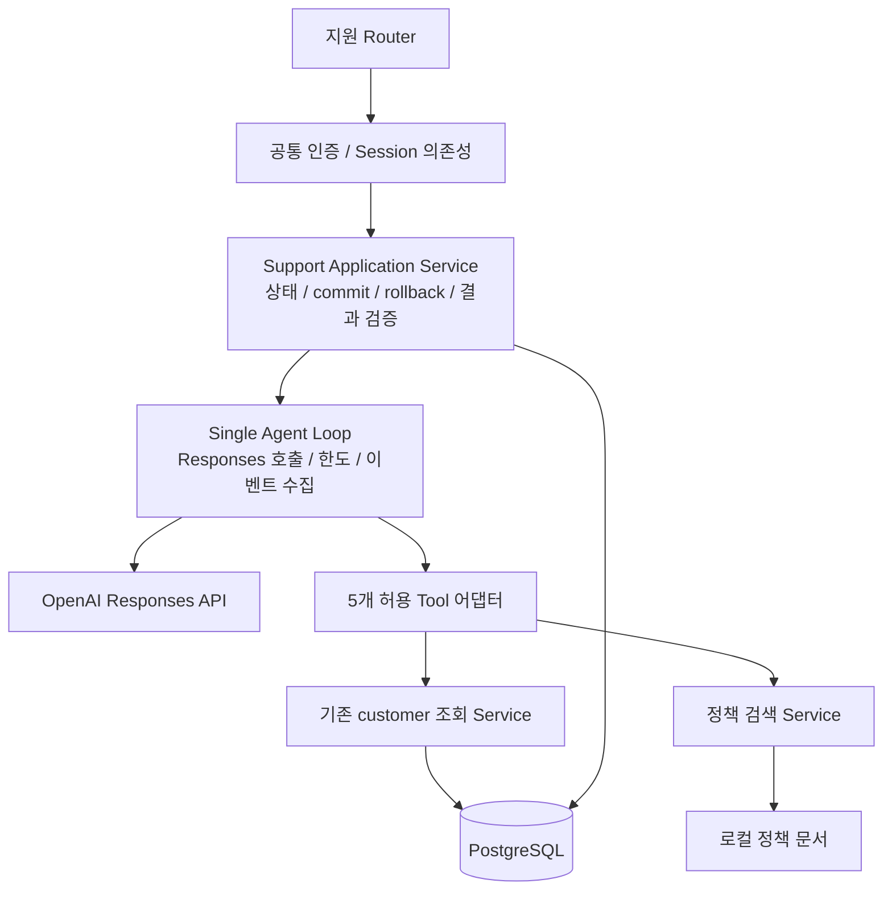

# Design

## Context

변경 목적과 범위는 [proposal.md](proposal.md), 외부 동작은 [support-requests](specs/support-requests/spec.md), [support-diagnosis](specs/support-diagnosis/spec.md), [policy-search](specs/policy-search/spec.md)를 기준으로 한다.

기존 구현에서 확인한 통합 지점:

- `app/services/customer.py`는 `authenticate`와 frozen `CallerContext`, 조직 범위를 강제하는 네 조회 함수를 제공한다. HTTP에 의존하지 않고 Pydantic DTO 또는 `CustomerError`를 반환한다.
- `app/api/routes.py`에 인증·Session 의존성과 조회 Router가 함께 있다. 인증 SELECT부터 SQLAlchemy autobegin이 발생한다.
- `app/db.py`의 `session_scope`는 예외 rollback/종료를 담당하고 정상 종료 시 commit하지 않는다. Seed는 별도 `session.begin()`으로 저장한다.
- Base가 `app/models/customer.py`에 있고 DB 초기화·테스트가 그 모듈만 import한다. 새 모델은 명시적 등록이 필요하다.
- 기존 pytest는 전용 PostgreSQL schema와 외부 트랜잭션/savepoint로 격리한다. 현재 SDK·정책·지원 모델은 없다.

이 설계는 `study/backend-foundation-architecture-review.md`의 R1~R3 통합 제약을 반영한다. 기존 고객 조회 명세와 충돌하는 변경은 발견하지 않았다.

## Goals / Non-Goals

**Goals:** Application이 인증·실행·저장 경계를 소유하며 Agent는 허용된 조회와 진단을 선택한다. 얇은 함수와 기존 Session/DTO로 HTTP부터 실제 저장까지 추적 가능한 MVP를 만든다.

**Non-Goals:** 범용 Agent/Repository/Unit of Work, 자동 재실행·Resume, Background Task, 실시간 Trace 스트리밍은 만들지 않는다. 나머지 제외 범위는 proposal을 따른다.

## Decisions

### D1. 기존 MVP의 네 지원 API와 동기 실행

`docs/mvp.md`의 생성·diagnose·결과·traces 경로를 채택한다. 생성과 실행을 분리하면 실패해도 문의 원문이 보존되고 조회 경로가 명확하다. 생성 요청에 자동 진단을 결합하는 대안은 실행 실패와 생성 실패가 섞여 제외한다.

| API | 계약 |
|---|---|
| POST `/support/requests` | content만 입력, trim 후 1~4000자, 추가 필드 금지, 201 문의 DTO |
| POST `/support/requests/{id}/diagnose` | body 없이 한 번 동기 실행, 저장된 종료 DTO 200 |
| GET `/support/requests/{id}` | 문의·status·nullable diagnosis/error_code 및 UTC 시각 200 |
| GET `/support/requests/{id}/traces` | sequence 오름차순 `{items: [...]}` 200 |

pending → running → completed/failed. completed 재호출은 결과를 반환하고 running/failed는 409 `conflict`다. 재진단은 새 문의를 생성한다. needs_information/escalate는 유효한 업무 결과이므로 completed다. 처리 가능한 Agent 실패는 failed를 저장하여 200으로 전달하고, DB 실패는 503으로 전달한다. UI는 HTTP 200만으로 진단 성공을 판단하지 않고 status/outcome을 읽어야 한다.

같은 조직의 모든 역할에 같은 지원 API 접근을 적용한다. 조직 범위 조회 쿼리로 다른 조직과 없는 문의를 동일 404로 처리한다. 동일 조직 문의 공유는 기존 조회 권한을 이어받는 MVP 결정이며 실제 고객 데이터에 적용하기 전 별도 개인정보 요구를 검토한다.

### D2. 최소 모듈 경계와 실행 흐름

추가 위치는 `app/api/support.py`, `app/schemas/support.py`, `app/models/support.py`, `app/services/support.py`, `app/agent/loop.py`, `app/agent/tools.py`, `app/services/policy.py`, `policies/`로 한정한다. 작은 Python 파일 단위이며 플러그인 등록·상속 계층을 만들지 않는다.

Router는 입력·의존성 연결과 HTTP 변환을 맡는다. Support Service는 문의 범위 검사·상태 전이·트랜잭션·최종 검증·저장을 맡는다. Loop는 SDK 응답 처리와 제한 검사, 메모리 이벤트 수집을 맡으며 ORM 쓰기를 하지 않는다. Tool은 DTO 직렬화와 안전한 오류 관찰을 맡고 commit하지 않는다.

`app/api/dependencies.py`로 `get_session`, `get_context`, `SessionDep`, `ContextDep`, bearer만 이동한다. 고객 Service/CallerContext는 그대로 두고 Router와 테스트가 동일 dependency 함수 객체를 참조하도록 import를 맞춘다. 기존 `routes.get_session` import는 필요하면 동일 객체의 import 별칭으로 유지할 수 있다. 고객 Service를 클래스·Repository로 재작성하는 대안은 재사용 이점이 없어 제외한다.

### D3. Tool과 신뢰된 컨텍스트

| Tool 입력 | 연결 | 관찰 데이터 |
|---|---|---|
| get_user(user_id: UUID) | `customer.get_user(session, context, user_id)` | UserDTO |
| get_organization(organization_id: UUID) | `customer.get_organization(...)` | OrganizationDTO |
| get_subscription(organization_id: UUID) | `customer.get_subscription(...)` | SubscriptionDTO |
| get_payment_history(organization_id: UUID) | `customer.get_payment_history(...)` | PaymentHistoryDTO |
| search_policy(query: str) | `policy.search_policy(query)` | 최대 3개의 문서 items |

Tool 이름의 고정 allowlist와 Pydantic 인자 검증을 사용한다. SDK Function Schema는 strict, object의 additionalProperties=false, 모든 정의 필드 required로 구성한다. UUID/길이/추가 인자는 Application에서도 검증한다. Schema 적합성이 인가를 대신하지 않는다.

Session과 CallerContext는 Python 실행 경계에서만 주입한다. 실행 호출자를 기존 인증으로 검증하고 문의와 조직이 같음을 확인한다. 기본 진단 대상은 `requester_user_id`이며 prompt에는 대상 ID, 인증 조직 ID, 문의 내용, 기준 UTC 시각을 제공한다. 실행자의 역할을 문의 당사자 역할로 대신하지 않는다. 필요하면 모델이 같은 조직의 다른 사용자를 조회할 수 있고 기존 Service가 범위를 통제한다.

관찰은 `{ok, data, error_code, trace_sequence}` 형태로 통일한다. data는 기존 DTO의 `model_dump(mode="json")` 또는 정책 items다. not_found, invalid_arguments, unknown_tool은 안전한 관찰로 다음 판단에 넘긴다. 부재가 다른 조직 조회인지 실제 부재인지 설명하지 않는다. unauthorized는 실행 실패, SQLAlchemy 오류는 DB 실패, 예상하지 못한 Tool/정책 로딩 오류는 tool_error로 중단한다. HTTP JSONResponse를 Tool 반환값으로 사용하지 않는다.

고객 도메인과 정책 문서는 읽기 전용이다. Support Application이 문의·진단·Trace를 쓰는 것은 Agent Tool 쓰기 권한을 의미하지 않는다.

### D4. Responses Loop와 실행 제한

OpenAI Python SDK의 동기 `responses.create`만 감싸는 작은 호출 함수/주입 지점을 둔다. 별도 Agents SDK나 범용 Provider interface는 필요하지 않다. 모델과 Key는 환경 설정에서 읽고 특정 모델명·가격은 이 Change에서 고정하지 않는다. 기존 `Settings(database_url, bearer_tokens)` 사용은 추가 설정의 기본값으로 유지하며 Agent 설정이 없는 경우 기존 읽기 API와 문의 접수/조회는 동작한다. 진단 시 누락 설정은 `llm_error`로 실패 저장하며 설정값은 노출하지 않는다.

1. Application이 실행 시작을 확정한 후 monotonic deadline, 고정 기준 UTC, 문의·대상 정보를 준비한다.
2. instructions, 누적 input, 다섯 function tools와 최종 JSON Schema를 Responses에 전달한다.
3. 응답의 function_call을 순서대로 검증·실행한다. 각 call_id에 맞춘 function_call_output을 JSON 문자열로 생성한다. 모델이 근거를 연결할 수 있도록 관찰의 trace_sequence를 제공한다.
4. 이전 response.output의 필요한 모든 항목(반환된 reasoning item 포함)과 Tool output을 메모리 input에 순서대로 누적하여 재호출한다. Tool 결과만 보내 맥락이 사라지는 방식은 사용하지 않는다.
5. function_call이 있으면 그 턴의 텍스트를 최종 진단으로 확정하지 않는다. 호출이 없고 응답이 완료되었으면 최종 구조·근거를 검증하고 종료한다.
6. refusal, incomplete, 비어 있거나 잘못된 출력, 호출/시간 한도는 즉시 종료한다. 이번 MVP는 출력 교정용 추가 재시도 루프를 두지 않는다.

provider 저장에 의존하지 않도록 `store=false`와 수동 input 누적을 선택한다. stateless 응답의 encrypted reasoning 항목도 후속 입력에 보존하되 실행 메모리에만 둔다. 공식 문서상 `include=["reasoning.encrypted_content"]`는 호환성을 위해 허용되지만 필수는 아니다. 최종 출력은 Responses의 JSON Schema 형식과 Pydantic 검증을 사용한다. Tool 호출은 `parallel_tool_calls=false`로 단순화하되 여러 호출이 돌아온 경우에도 순차 처리한다. call_id 누락/중복으로 대응 관계를 만들 수 없는 응답은 invalid_output으로 중단한다.

이 API 연결 방식은 [공식 Function calling 문서](https://developers.openai.com/api/docs/guides/function-calling)의 call_id별 결과 전달·strict Schema·reasoning item 전달 계약과 [Reasoning models 문서](https://developers.openai.com/api/docs/guides/reasoning#preserve-reasoning-without-stored-responses)의 stateless 맥락 보존을 기준으로 한다. 세부 SDK 시그니처와 선택 모델의 지원 기능은 구현 때 설치 버전으로 확인한다.

기본 설정: `AGENT_MAX_STEPS=8`(모델 호출 수), `AGENT_MAX_TOOL_CALLS=16`(잘못된 호출도 포함), `AGENT_TIMEOUT_SECONDS=60`. 각 LLM 요청 timeout은 min(20초, 남은 실행 시간), SDK max_retries=0으로 둔다. 한도를 초과하는 호출을 시작하지 않고 반환 후에도 deadline을 확인한다. 여러 Tool이 있는 응답은 매 호출 전 검사한다. DB connect/statement 대기는 남은 시간에 맞는 유한 timeout으로 제한한다. 종료 저장은 Agent 60초 한도 밖에서 유한 DB timeout으로 수행한다. 총 HTTP 지연시간이 정확히 60초 이내라는 보장은 하지 않는다.

시간·SDK 호출을 작은 함수로 주입하여 timeout/후속 관찰을 자동 테스트한다. usage는 공급자가 준 input/output/total token만 기록하며 미제공 값은 null이다. 비용 추정 및 평가 실행기는 추가하지 않는다.

### D5. Data Model과 명시적 모델 등록

| 모델 | 주요 필드 | 제약 |
|---|---|---|
| SupportRequest | id UUID, requester_user_id FK User, organization_id FK Organization, content, status, created_at, started_at nullable, finished_at nullable, error_code nullable | status CHECK, content 길이 CHECK, 조직 index, FK RESTRICT |
| Diagnosis | id UUID, support_request_id FK, outcome, summary, causes JSONB, next_actions JSONB, evidence JSONB, created_at | request_id UNIQUE, outcome CHECK, FK RESTRICT |
| AgentTrace | id UUID, support_request_id FK, sequence, event_type, step nullable, call_id nullable, tool_name nullable, arguments/observation JSONB nullable, error_code nullable, duration_ms nullable, model/response_id/usage nullable, created_at | (request_id, sequence) UNIQUE, sequence>0 CHECK, event_type CHECK, FK RESTRICT |

시각은 timezone-aware UTC, 새 레코드 UUID는 Application에서 생성한다. 참조하는 생성자가 문의 조직에 속하는지는 Application이 인증된 값으로 생성할 때 보장한다. 상태/결과 배열의 구조는 Pydantic으로 검사하고 DB에는 최소 관계·열거값·유일성 제약을 둔다. completed이면 진단 하나와 finished_at, failed이면 진단 없이 finished_at/error_code라는 상태 간 일관성은 Application의 원자 저장으로 보장한다. ORM 간 복잡한 트리거는 만들지 않는다.

최종 결과의 causes/next_actions는 문자열 배열, evidence는 `{trace_sequence: int, policy_document_id: str|null, statement: str}` 배열이다. diagnosed는 비어 있지 않은 causes와 evidence, 나머지 outcome은 비어 있지 않은 next_actions를 요구한다. 일반 근거는 같은 실행의 Tool 관찰을 참조하며, diagnosed의 근거에는 최소 한 성공 관찰이 필요하다. 정책 ID는 참조한 search_policy 관찰의 실제 items에 있어야 한다. 내용의 논리적 타당성까지 자동 검증됐다고 주장하지 않는다.

Trace event_type은 execution_started, llm_response, tool_result, final_result, execution_failed, execution_completed로 제한한다. 실패 LLM 호출도 llm_response에 안전한 error_code를 기록한다. 한 Tool 호출은 한 tool_result에 입력·관찰·오류·소요시간을 함께 담는다. invalid_arguments는 파싱 전 raw 문자열을 저장하지 않고 arguments=null과 오류 코드만 남긴다. 최종 결과 검증 실패도 final_result의 오류로 기록하며 검증되지 않은 출력 전문은 저장하지 않는다. 헤더/설정/원본 SDK 응답/내부 reasoning은 저장하지 않는다.

공통 `app/models/base.py`로 Base만 옮기고 기존 customer 모듈이 같은 Base를 import하여 기존 import 호환성을 유지한다. `app/models/__init__.py`는 Base와 customer/support 모델을 명시적으로 import한다. `app/db.py` 초기화 CLI와 `tests/conftest.py`는 이 진입점을 사용한 뒤 metadata.create_all을 호출한다. 다른 Base나 자동 탐색 registry를 추가하는 대안은 등록 누락과 불필요한 복잡성을 늘려 제외한다.

### D6. Application의 트랜잭션 소유권

한 HTTP 요청의 기존 주입 Session을 재사용한다. `session_scope`에 자동 commit을 추가하지 않고 지원 Application이 명시적으로 commit/rollback한다. 조회 Service와 Tool은 트랜잭션을 소유하지 않는다. 인증·범위 조회로 이미 autobegin이 시작되므로 Application 진입에서 무조건 `session.begin()`을 호출하지 않는다.

| 단계 | 소유자와 처리 | 실패 후 상태 |
|---|---|---|
| 문의 생성 | 인증 SELECT로 열린 transaction에 문의 추가·flush·응답 DTO 구성·commit | rollback, 503, 문의 생성 성공 보고 금지 |
| 실행 시작 | 같은 조직/pending 조건의 원자 UPDATE로 running/started_at 설정 후 commit | rollback, LLM 호출 금지, 503 |
| Agent 실행 | 같은 Session의 읽기 transaction, Trace/결과는 메모리 수집 | 안전한 종료 이벤트 수집; DB 오류면 먼저 rollback |
| 종료 저장 | 실행 중 읽기 transaction을 마치며 상태·Diagnosis·전체 Trace 추가/flush/DTO 구성 후 한 commit | 전체 rollback, 503 |
| 저장 실패 기록 | rollback 후 동일 Session이 사용 가능하면 새 transaction에서 failed/database_error와 수집 Trace를 한 번 저장·commit | 실패하면 다시 rollback, 원래 503 유지; running 잔존 가능 |

pending 조건 UPDATE의 영향 행 수가 0이면 상태를 다시 확인한다. completed는 저장 DTO, running/failed는 409, 범위 밖/부재는 404다. 동시 요청 테스트는 실제 두 Session으로 검증한다. running을 확정한 뒤에는 실행 소유자만 종료 저장을 수행하며 완료된 결과를 덮어쓰지 않는다.

처리 가능한 LLM/Tool/검증/한도 오류는 실패 상태와 전체 Trace를 한 트랜잭션으로 저장한다. 읽기 DB 실패는 rollback 후 실패 저장을 한 번 시도하고 원래 요청은 503이다. 종료 commit 오류 역시 성공으로 보고하지 않는다. 장애 중 실패 저장까지 성공한다고 보장하지 않는다. commit 도중 연결이 끊어져 성공 여부가 불명확하면 재연결 후 상태를 먼저 읽고 이미 completed인 결과를 failed로 덮어쓰지 않는다.

지원 Application 안의 예상하지 못한 실행 예외도 안전한 tool_error로 정리하여 가능한 실패 기록을 남긴다. 프로세스 kill/재시작은 메모리 Trace를 잃고 running이 남을 수 있다. 자동 복구·재시도 API는 범위 밖이며 개발 환경에서는 새 문의로 재실행한다.

대안인 Tool별 Session이나 별도 실행 저장 Session은 구현·테스트 주입 복잡도를 늘려 이번에는 제외한다. 한 Session의 읽기 transaction이 LLM 대기 중 유지되는 비용은 60초 실행 한도로 제한한다. PostgreSQL 기본 READ COMMITTED이므로 전체 실행이 같은 고객 스냅샷을 본다고 보장하지 않고 각 관찰값을 Trace에 보존한다.

### D7. 정책 문서와 검색

`policies/plans.json`, `permissions.json`, `troubleshooting.json`에 document_id/title/keywords/content를 가진 소규모 문서를 둔다. 구조가 있는 JSON은 frontmatter parser 의존성 없이 읽을 수 있다. 자동 수집·Vector DB·embedding·OpenAI file_search는 사용하지 않는다.

query를 casefold/공백 정규화 후 공백 단위 토큰으로 나눈다. title·keywords·content 중 토큰이 나타나면 해당 토큰 점수 1, 합산 점수>0인 문서만 선정하고 점수 내림차순/document_id 오름차순으로 최대 3개를 반환한다. 한국어 형태소 분석 없이도 찾을 수 있도록 '초대', '팀원', '권한', '결제', '만료', plan/status 영문 키워드를 문서에 포함한다. 부분 문자열 검색의 한계는 테스트와 정책 키워드로 관리한다. 실행 시작 시 문서 집합을 한 번 로드하여 같은 실행 내 정책 변경 영향을 피한다.

정책은 MVP 가상 서비스의 새 문서이며 다음 최소 규칙을 채택한다: 모든 플랜의 실효 인원 제한은 Organization.member_limit, 초대 권한은 owner/admin, member는 관리자에게 요청; 초대는 활성·미만료 구독과 member_count < member_limit 필요; past_due/expired/canceled는 구독 문제로 안내; failed/pending 결제만으로 다른 저장 상태를 덮어쓰거나 결제 성공을 확정하지 않는다. 플랜별 고정 한도·환불 자격·실제 조치는 새로 가정하지 않는다. 기준 UTC와 저장 상태/expires_at이 불일치하면 관찰된 사실을 설명하고 추가 확인/이관을 선택하도록 안내한다.

### D8. 자동 테스트와 수동 확인의 역할

| 검증 | 방식 |
|---|---|
| Loop 후속 판단/최종 근거 | 주입한 Responses fake가 다음 호출의 Tool 관찰/call_id/누적 항목을 검사 |
| 복합 초대·구독·결제 문의 | 고정 Seed와 기준 UTC, scripted Tool 선택 후 HTTP 생성→진단→GET 결과/Trace |
| 역할·한도·구독 부재·정보 부족 | 동일 조직 fixture 및 고정 정책, outcome/근거/읽기 전용 snapshot 검사 |
| 입력·권한·위조·조회 오류 | HTTP/Tool 직접 호출, 교차 조직 및 not_found 동일성 |
| 한도·timeout·거부·잘못된 출력 | fake SDK/clock, 후속 호출 중단 및 failed/Trace 검사 |
| 실제 commit/rollback·동시 claim | 별도 PostgreSQL 연결/Session으로 재조회 및 두 실행 요청 검사 |
| Base 등록 | Router import에 기대지 않는 DB 초기화와 테스트 초기화 검사 |
| 회귀 | 기존 전체 pytest 유지·실행 |

기존 savepoint fixture는 일반 테스트에 재사용한다. durable commit과 장애 rollback 검증은 외부 rollback fixture만으로 증명하지 않고 테스트 schema 안의 독립 연결을 사용한다. 고정 Seed의 날짜를 현재 날짜와 비교하지 않고 테스트 기준 UTC를 주입한다. 실제 모델 테스트는 환경 설정이 있을 때 수동 smoke로 실행하고 실제 결과와 fake 통합 테스트를 구분한다. 품질 비교·정확도/비용 성과는 다음 Evaluation Change의 책임이다.

## Risks / Trade-offs

- [LLM 대기 중 DB transaction/connection 점유] → 짧은 실행·DB timeout, 종료 일괄 저장. 운영 부하가 실제 문제가 되면 후속 Change에서 분리한다.
- [프로세스 종료/지속 DB 장애로 running 및 Trace 유실] → 실패 저장은 가능한 경우 한 번 수행하며 잔존 상태를 문서화한다. 자동 복구는 이번에 구현하지 않는다.
- [LLM이 타당하지 않은 원인을 확정] → 구조·근거 참조는 검증하지만 의미 검증은 수동 smoke와 이후 Evaluation에서 확인한다.
- [동일 조직의 문의/Trace 공유] → 현재 조직 권한과 일관된 MVP 결정이다. 실제 데이터 적용 시 보존 기간·열람 범위·민감 정보 마스킹 요구를 검토한다.
- [한국어 단순 검색 누락] → 고정 키워드·동점 정렬·검색 부재 테스트. 의미 검색의 도입은 필요가 확인될 때 판단한다.

## Migration Plan

1. 구현 시 기존 Base import 호환성과 모델 진입점을 연결한 뒤 전용 개발/테스트 DB에서 초기화한다. 새 세 테이블 생성에 기존 create_all 방식을 유지하고 고객 테이블 변경은 하지 않는다.
2. SDK·정책·환경 설정을 추가하고 Key/모델 없이 기존 Backend가 시작되는지 회귀 검증한다. Key는 환경 변수로만 공급한다.
3. 신규 테스트와 기존 전체 pytest를 통과한 뒤 설정된 개발 환경에서 복합 문의 수동 smoke를 수행한다. 실제 호출은 이번 명세 작성 단계에서 수행하지 않는다.
4. 코드 rollback 시 이전 Backend로 돌아갈 수 있고 지원 테이블은 보존하여 데이터 손실을 피한다. 자동 drop이나 새 migration framework는 도입하지 않는다.

## Open Questions

- 구현 환경에서 사용할 `OPENAI_MODEL`, 설치 SDK 버전 및 계정 접근 가능 여부는 구현 시작 시 확인한다. function calling/JSON Schema 지원 모델을 선택하며 이 확인은 API·데이터·작업 범위를 바꾸지 않는다.
- 기본 실행 한도의 실제 지연시간/토큰 사용은 수동 smoke에서 확인한다. 설정값 조정은 허용하지만 무한 실행·숨은 재시도는 허용하지 않는다.
