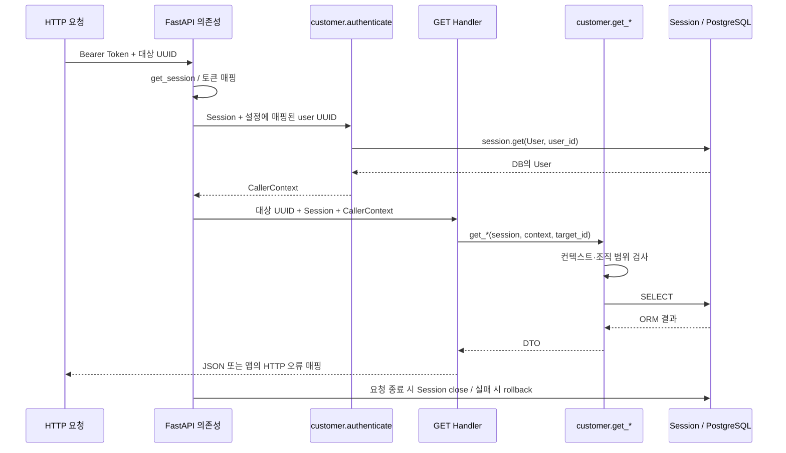

# Backend Foundation Architecture & Code Structure Review

검토일: 2026-10-13. 대상: 현재 `backend-foundation` 작업 트리.

**판단: 현재 Backend 구조를 유지한다. 다음 Change 이전의 필수 리팩터링은 없다.** 저장 기능과 새 모델을 추가할 때 트랜잭션 소유권·모델 등록을 연결하고, 공통 API 의존성은 실제 재사용이 생길 때 분리하는 방향을 권장한다.

이번 판단은 테스트 통과를 구조 적절성의 근거로 삼지 않고, 실제 import·함수 호출·데이터 흐름과 다음 Change의 확정된 요구를 중심으로 내렸다. `docs/mvp.md`, `AGENTS.md`, Change의 `design.md`와 두 spec, `docs/backend-foundation-design.md`, 기존 [독립 코드 리뷰](backend-foundation-code-review.md)를 참고했다. 기존 리뷰의 PostgreSQL 69개 통과 결과는 기능 검증 이력이며, 이번 리뷰에서 테스트를 다시 실행하지 않았다.

## 1. Architecture Overview

### 실제 디렉터리와 책임

```text
app/
  main.py                 # 앱 조립, Engine 수명, HTTP 오류 매핑
  config.py               # 환경 설정 → Settings
  db.py                   # Engine, Session 수명, DB 검증, 초기화 CLI
  seed.py                 # 고정 fixture, upsert, Seed CLI 트랜잭션
  api/
    routes.py             # 요청 Session·인증 의존성 + 네 GET Handler
  services/
    customer.py           # CallerContext, 사용자 확인, 조직 경계, 네 조회
  models/
    customer.py           # 공통 Base와 네 ORM 모델
  schemas/
    customer.py           # 조회 DTO와 Pydantic 설정
tests/
  conftest.py              # PostgreSQL schema·Session·앱 fixture
  test_backend.py          # DB·Service·API 테스트
```

각 패키지의 `__init__.py`는 비어 있다. 구현 파일을 명시적으로 import하는 현재 방식에 별도의 export 목록이나 `__all__`은 필요하지 않다. 주요 앱 구현은 8개 파일, 총 416줄이다. 네 조회를 구현하기 위해 모델마다 파일을 만들거나 계층별 인터페이스를 추가한 구조가 아니다.

### 실제 import 방향

AST로 로컬 구현 모듈의 import를 확인했다. `from app.services import customer`도 `app.services.customer` 의존성으로 포함했으며, 함수 안의 CLI import까지 분석했다. 현재 로컬 import 그래프에 순환은 없다.

| 모듈 | 직접 의존하는 로컬 구현 모듈 |
|---|---|
| `app.main` | `api.routes`, `config`, `db`, `services.customer` |
| `app.api.routes` | `db`, `schemas.customer`, `services.customer` |
| `app.services.customer` | `models.customer`, `schemas.customer` |
| `app.db` | `models.customer` — `main()`의 스키마 초기화에서만 import |
| `app.seed` | `db`, `models.customer` |
| `app.config`, `models.customer`, `schemas.customer` | 다른 앱 구현 모듈에 의존하지 않음 |

Service는 SQLAlchemy와 Pydantic에 의존하지만 FastAPI, Request, Settings, HTTP 응답에 의존하지 않는다. ORM은 Service나 API를 import하지 않는다. `db.py`의 ORM 의존성은 초기화 CLI에 한정되어 있고, 요청 Session 생성이 특정 모델이나 Service를 호출하지는 않는다.

### 요청부터 DB까지 실제 흐름

`app/main.py:26`에서 Settings와 Engine을 생성해 `app.state`에 두고 router를 등록한다. 요청에서는 Handler와 인증 의존성이 같은 `get_session` 의존성을 사용한다. FastAPI의 기본 의존성 캐시로 동일 요청에서는 같은 Session이 전달된다.



핵심 위치는 `app/api/routes.py:17`, `:25`, `:38`, `app/services/customer.py:29`, `:36`, `:44`, `app/db.py:17`이다. Handler가 SQL이나 권한 규칙을 구현하지 않고, Service가 DTO를 만드는 지점까지 한 파일에서 추적할 수 있다.

## 2. Architecture Assessment

### 적절하게 설계된 부분

**Service 경계는 실제 재사용 목적이 있다.** `get_user`, `get_organization`, `get_subscription`, `get_payment_history`의 공통 입력은 Session·CallerContext·대상 UUID이며 결과는 DTO다. Agent와 Workflow가 HTTP 요청을 만들거나 Handler를 직접 호출할 필요가 없다. 데이터 조회와 조직 격리를 이 경계에서 함께 처리하므로 실행 방식별로 권한 규칙을 중복 구현하지 않아도 된다.

**Session과 Engine의 소유권을 조회 함수 밖에 둔 선택이 적절하다.** Engine은 앱 생성·종료에서 관리하고, Session은 요청 의존성에서 제공한다. Service가 자체 Engine·Session을 열거나 commit하지 않으므로 Application이 여러 조회와 저장의 실행 범위를 정할 수 있다. 이는 재사용의 제약보다 유연성을 제공한다. 현재 `session_scope`는 읽기 요청의 자원 관리에 맞는 함수이며 저장용 자동 트랜잭션 관리자라는 의미는 아니다.

**ORM과 DTO의 분리는 중복을 정당화할 실질적인 이유가 있다.** ORM은 FK·관계·저장 제약을 담당하고, DTO는 외부 조회 필드와 계산된 member_count를 표현한다. ORM 객체를 Tool·HTTP에 그대로 노출하면 Session과 lazy loading의 수명이 외부 실행에 따라 달라질 수 있는데, 현재 변환은 Service 안에서 완료된다. DTO가 Pydantic 모델이라는 이유만으로 HTTP 전용 모델이 되는 것은 아니다. 이를 다른 DTO 체계로 다시 감쌀 필요는 없다.

**공통 helper는 실제 규칙을 묶는다.** `require_organization`은 조직 일치 검사와 조직 존재 확인을 묶어 세 조회가 같은 실패 의미를 사용하게 한다. `require_context`는 네 함수의 필수 컨텍스트 검사를 공유한다. 단순히 SELECT를 감싼 범용 Repository나 여러 단계를 통과하는 서비스 객체는 없다.

**설정·예외의 위치도 현재 규모에 맞는다.** `Settings.from_env()`는 환경 문자열을 앱 입력으로 바꾸고, `create_app(settings)`는 테스트 등에서 그 입력을 대체할 수 있게 한다. DB CLI는 인증 토큰이 필요하지 않아 Settings 전체를 강제로 로드하지 않는다. `CustomerError`는 HTTP 상태를 가지지 않고 `main.py`가 HTTP로 변환한다. 전용 configuration framework나 범용 예외 계층은 필요하지 않다.

### 응집도와 코드 구성

`services/customer.py`의 인증 관련 함수는 Bearer 파싱을 하지 않는다. DB User에서 조회 범위를 결정하는 역할이며 같은 User·조직 데이터와 연결된다. 71줄인 현재 파일에서 CallerContext·오류·조직 검사·네 조회를 분리하면 읽는 파일만 늘어날 가능성이 크다. 독립적인 인증 제품이나 다양한 실행 컨텍스트가 없는 현재에는 이 배치를 유지하는 편이 낫다.

`api/routes.py`는 요청 의존성과 네 Handler를 함께 담지만 55줄이며 실행 흐름을 읽기 쉽다. 현재 한 router만 있을 때 의존성 파일을 별도로 만드는 이득은 작다. 다음 router가 같은 의존성을 재사용할 때는 분리할 구체적인 이유가 생긴다.

모델과 DTO의 `customer.py`는 고객 지원 조회라는 하나의 작은 데이터 묶음을 표현한다. User·Organization·Subscription·Payment를 각각 독립 패키지로 나누면 관계 정의·조회·Seed를 이해하기 위한 이동이 늘어난다. 현재 파일 이름과 규모는 적합하다. 다음 문의·Trace 모델은 별도 책임이므로 같은 파일에 계속 쌓을 이유는 없다.

`DTO`의 공통 `from_attributes=True` 설정과 SQLAlchemy의 `DeclarativeBase`는 사용 중인 라이브러리의 필요한 구성이다. 미래 기능을 위한 Base Service, 범용 Tool framework, Repository, Unit of Work 등을 추가할 근거는 없다.

### 구조적 문제와 현재 규모 적합성

현재 실행 경로에서 책임 분리를 깨뜨리거나 다음 Change를 막는 구조적 결함은 발견하지 않았다. Service의 직접 SQLAlchemy 의존성, API와 Service의 동일 DTO 사용, `main.py`의 오류 매핑은 MVP의 작은 조회 기반에서 의도적인 결합이며 유지 비용보다 이점이 크다.

다만 현재 코드는 읽기 요청만 완성된 상태다. 저장 트랜잭션과 추가 ORM 모델의 등록까지 준비된 것으로 해석해서는 안 된다. 이 두 지점은 실제 구현에서 확인되는 통합 작업이며, 다음 절에서 현재 결함과 구분해 정리한다.

## 3. Findings & Recommendations

**지금 수정해야 할 Architecture Finding은 없다.** 아래 항목은 기존 코드의 버그를 주장하는 것이 아니라, 확정된 `support-agent` 기능을 연결할 때 필요한 권장 사항이다.

### R1. 저장 트랜잭션의 소유권은 새 Application 실행 흐름에서 명시한다

- **코드 위치:** `app/db.py:17`, `app/api/routes.py:25`, `app/services/customer.py:29`, `app/seed.py:60`.
- **현재 구조 및 실제 제약:** 요청 Session wrapper는 성공 시 commit하지 않는다. 인증의 `session.get(User, user_id)`부터 SQLAlchemy 기본 autobegin이 작동한다. 따라서 같은 Session으로 새 Handler에서 무조건 `with session.begin()`을 시작하는 구조는 이미 시작된 트랜잭션과 충돌한다. 저장 없이 읽기만 하는 현재 Handler에는 문제가 없다.
- **개선을 고려하는 이유:** 문의·결과·Trace 저장을 추가하면 누가 commit하고 어느 실패에서 무엇을 보존할지 정해야 한다. 기존 wrapper만 사용하는 것으로 저장 완료를 보장할 수는 없다. 기본 autoflush도 켜져 있어, 쓰기 상태가 있는 Session을 조회 Service에 전달하면 조회 과정에서 pending 변경이 flush될 수 있다. Service 코드가 SELECT만 포함한다는 사실과 Application의 Session 상태는 구분해야 한다.
- **대안과 Trade-off:** 같은 요청 Session을 전달하고 Application이 기존 트랜잭션의 저장·commit을 명시하면 변경이 작다. 새 Session으로 실행·저장 단계를 구분하면 경계는 더 명확해지지만 Session 연결과 실패 처리 코드가 늘어난다. 모든 요청의 `session_scope`에 자동 commit을 추가하면 간단해 보이지만 현재 읽기 경로까지 저장 정책을 암묵적으로 공유하게 된다.
- **권장 방향:** 우선 기존 주입 구조를 유지하고 새 Application 실행 함수가 commit·rollback과 실패 결과 보존의 책임을 갖게 한다. 이미 시작된 트랜잭션을 고려한다. 조회 Service와 개별 Tool이 임의로 commit하게 만들지 않는다. 단일 동기 진단 흐름에 Session 하나를 쓰는 선택도 가능하며, 선제적으로 Tool별 Session 체계를 도입할 필요는 없다. Session의 조회 트랜잭션을 LLM 호출 동안 유지할지 종료할지는 다음 실행·저장 계약에서 함께 결정한다.
- **적용 시점:** **다음 Change에서**, 저장 요구와 실패 계약을 구현할 때. 지금 wrapper를 변경할 필요는 없다.

이 제약은 본 프로젝트의 Session 생성 방식과 설치된 SQLAlchemy의 `autobegin`·`autoflush` 기본값, 진행 중인 트랜잭션에서 `begin()`이 거부되는 구현을 읽어 확인했다. 이번 리뷰에서 새 저장 시나리오를 실행한 결과로 제시하는 것은 아니다.

### R2. 새 모델은 같은 Base에 등록하고 초기화·테스트에서 확실히 import한다

- **코드 위치:** `app/models/customer.py:8`, `app/db.py:35`, `tests/conftest.py:13`, `:38`.
- **현재 구조 및 실제 제약:** Base는 고객 모델 파일에 있으며 초기화 CLI와 fixture가 그 파일을 import해 현재 네 테이블을 등록한다. 새 문의·Trace 모델을 다른 파일에 정의하는 것만으로 모든 초기화 경로에서 해당 클래스가 import되는 것은 아니다. `metadata.create_all()`은 그 시점에 등록된 테이블을 대상으로 한다.
- **개선을 고려하는 이유:** 다음 Change는 실제로 ORM 모델을 추가한다. 앱 router를 통해 우연히 import되는 경로와 CLI·테스트의 모델 등록 경로가 달라지면 초기 스키마 구성이 호출 경로에 의존한다.
- **대안과 Trade-off:** CLI와 fixture에서 모델 모듈을 명시적으로 import하는 방법은 가장 작은 수정이다. 모델 패키지의 얇은 진입점에서 전체 모델을 명시적으로 등록하고 양쪽이 이를 사용하면 초기화 기준을 한곳에서 관리할 수 있지만 import 순서를 확인해야 한다. 자동 탐색·동적 plugin registry는 이 규모에서 비용만 늘린다.
- **권장 방향:** 새 모델도 단일 Base를 공유하고, CLI·fixture가 동일한 명시적 모델 등록 경로를 사용하도록 연결한다. `models/base.py`로 Base만 분리하는 것은 새 파일이 Base를 공유할 때 선택할 수 있는 작은 정리이며, 필수 선행 작업은 아니다. 모델 등록을 위해 `models/__init__.py`에 얇은 import를 두는 것도 가능하다. 현재 빈 파일이 잘못되었다는 뜻은 아니며 `__all__`은 테이블 등록과 무관하다.
- **적용 시점:** **다음 Change에서**, 문의·Trace 모델을 추가할 때. 현재 네 모델을 미리 다시 나눌 필요는 없다.

### R3. 두 번째 router에서 재사용할 때 API 의존성을 옮긴다

- **코드 위치:** `app/api/routes.py:17`~`:35`, `tests/conftest.py:9`, `:67`.
- **현재 구조 및 실제 제약:** `get_session`, `get_context`, `SessionDep`, `ContextDep`가 고객 조회 router와 같은 파일에 있다. 별도 문의 router를 만들면 공통 인증·Session을 얻기 위해 고객 조회 모듈을 import하거나 의존성 구현을 복사하게 될 수 있다. 현재는 소비자가 하나이므로 과도한 책임 집중으로 보지 않는다.
- **개선을 고려하는 이유:** 문의 API에서도 동일한 인증 경계를 사용해야 한다. 이 시점에는 공통 의존성의 위치가 고객 조회 endpoint와 독립적일 실익이 생긴다.
- **대안과 Trade-off:** 기존 `routes.py`를 import하는 방법은 코드 이동이 없지만 문의 router가 고객 조회 router에 결합된다. 공통 부분만 `api/dependencies.py`로 옮기면 파일 하나와 import 수정이 추가되지만 재사용 위치가 명확해진다. 인증·설정·Session 각각을 여러 패키지로 나누는 것은 필요하지 않다.
- **권장 방향:** 새 문의 router가 기존 의존성을 재사용할 때만 작은 `dependencies.py` 분리를 고려한다. 고객 조회 함수, CallerContext, Service 오류까지 함께 이동시키지 않는다. 테스트의 `dependency_overrides`는 실제 Handler가 참조하는 동일한 `get_session` 객체에 적용되도록 import도 맞춘다.
- **적용 시점:** **다음 Change에서**, 별도 router와 두 번째 소비자가 생길 때. 지금은 유지한다.

## 4. Support-Agent Integration Readiness

### 대표 Tool 호출을 현재 구조에 대입

예를 들어 Agent가 자기 조직의 구독 상태를 확인하는 흐름은 다음과 같다. 이는 구현 계획을 설명하는 의사코드이며 이번 리뷰에서 추가한 기능이 아니다.

```text
POST 문의 진단 요청
  → 기존 HTTP 인증 의존성
  → DB User로 확인한 CallerContext
  → 새 Application의 진단 실행 함수
      → Agent 실행에 허용된 Tool 어댑터 제공
      → Tool 어댑터가 실행 소유의 Session과 CallerContext를 주입
      → customer.get_subscription(session, context, 대상 UUID)
      → SubscriptionDTO를 Tool 관찰값으로 직렬화
      → Application이 진단 결과·Trace를 저장
```

Tool의 외부 입력은 조회 대상이나 검색어다. Session과 CallerContext는 Application이 주입한다. 현재 Service 함수의 전체 시그니처를 LLM 입력으로 그대로 노출할 필요는 없다. Workflow도 동일한 Service를 직접 호출하고 같은 DTO를 사용하면 된다. 조회 Service 안에서 Agent 모드·Workflow 모드를 분기할 이유가 없다.

`CallerContext`는 UUID·role 값만 가진 frozen dataclass라 ORM 객체·Request·Session을 보관하지 않는다. 인증용 Session이 종료된 뒤에도 컨텍스트를 전달할 수 있다. 다만 객체 자체가 인증 출처를 증명하는 것은 아니다. 다음 실행 경로에서도 LLM·요청 body의 user_id·organization_id·role로 새 컨텍스트를 만들지 않고 신뢰된 Application 경계를 유지해야 한다.

현재 `CustomerError`와 SQLAlchemy 예외는 HTTP 없이도 발생할 수 있다. HTTP의 401/404/503 응답은 `main.py`의 adapter 동작이다. 새 진단 Application은 Tool의 not_found 같은 조회 실패와 실행을 중단해야 할 DB 실패를 어떻게 기록·전달할지 정해야 한다. Workflow·Evaluation에서 HTTP 오류 handler를 호출하거나 JSONResponse를 Tool 결과로 사용하는 구조는 필요하지 않다. 이 목적만으로 모든 Service를 새 예외 framework로 감쌀 필요도 없다.

### 재사용·추가·기존 코드 변경의 구분

| 구분 | 내용 |
|---|---|
| 그대로 재사용 | 네 조회 Service, 조직 검사, CallerContext, 조회 DTO, ORM 고객 모델, Engine 생성, 기존 인증 규칙과 Seed. |
| 다음 Change에서 추가 | 문의·진단 실행을 관리하는 Application 함수, Agent 호출과 읽기 Tool 어댑터, 문의·결과·Trace 모델과 입출력 계약, 해당 router·테스트. 구체적인 파일명과 실행·저장 단위는 새 명세에서 정한다. |
| 기존 코드 연결 필요 | `main.py`의 router·필요한 오류 처리 등록, 새 모델의 metadata 등록 경로, 실행용 설정. 저장의 commit 책임은 새 Application 흐름에 추가한다. |
| 재사용 발생 시 작은 이동 | 문의 router도 쓰는 Session·인증 의존성의 `api/dependencies.py` 분리. |
| 선제 변경 불필요 | 고객 조회 Service를 객체형 service·Repository로 전환, 도메인별 패키지 재구성, 자체 Unit of Work, async DB 전환, 범용 Tool framework, 컨텍스트 인증 장치 추가. |

Agent와 Workflow의 비교에 필요한 공통 경계는 이미 존재한다. 이후 차이는 Application이 조회 순서를 고정할지 Agent가 허용된 Tool을 선택할지에 있다. 고객 상태 조회와 접근 범위 검사는 동일한 함수로 유지할 수 있다. 문의·Trace 저장을 추가한다는 이유로 기존 읽기 Service에 쓰기 책임이나 진단 Prompt를 넣을 필요는 없다.

## 5. 최종 판단

**현재 아키텍처를 유지한다. 구조 재검토나 선행 리팩터링은 권장하지 않는다.**

현재 규모에서 계층별 실질적인 책임이 있고 의존성 방향은 자연스럽다. 요청부터 SELECT와 DTO 반환까지 추적이 짧으며 Agent·Workflow의 공통 조회 경계도 이미 확보되어 있다. 현재 구조를 다시 작성하는 비용을 정당화할 결함을 발견하지 않았다.

다음 Change 이전에 반드시 수정할 부분은 없다. 다음 Change를 구현하면서 자연스럽게 다룰 부분은 저장 트랜잭션의 소유권, 새 모델의 공통 Base·등록 경로, 두 번째 router가 재사용할 API 의존성이다. 앞의 두 항목은 새 기능의 통합 작업이고, 마지막 항목은 재사용이 생겼을 때의 작은 코드 정리다. 어느 항목도 현재 기능 검증을 무효화하거나 전면 아키텍처 변경을 요구하지 않는다.

이번 작업에서는 이 보고서만 생성했으며 소스·테스트·OpenSpec·기존 리뷰 문서는 변경하지 않았다. 분석은 현재 코드와 확정된 다음 기능을 대상으로 했고 아직 구현되지 않은 Agent 실행의 실제 동작이나 성능을 검증했다고 주장하지 않는다.
